# The 10-80-10 Principle: The Optimal Balance for Human-AI Synergy

The AI-Era Advantage: 5x Your Output Quality & Quantity with the 10/80/10 Rule of Human-AI Co-Creation.  
What has become possible precisely because we live in the AI era: "The 10:80:10 Principle," the golden ratio of human-AI co-creation that multiplies the quality and quantity of your output fivefold.

  

 

---
## Introduction — Why the "Design of Co-Creation" Determines Everything

In 2025, generative AI is rapidly widening the gap between people who can use it and people who cannot.

According to a longitudinal Gallup study of 22,368 U.S. workers (Q4 2025), 46% of workers now use AI at work. 
Yet only 12% use it every day. 
Most of the rest have "tried it but don't use it routinely": they experimented once and abandoned it, or touch it only a few times a month. 

But the heart of the problem is not whether you can use AI. 
**How you divide roles between yourself and AI** — whether or not you have this design philosophy — decisively shapes the quality and quantity of your output.

In a 2023 report, the McKinsey Global Institute estimated that generative AI could create $2.6 trillion to $4.4 trillion in economic value worldwide each year. 
That figure represents an increase of 15% to 40% on top of the value estimated in earlier analyses of AI. 
Yet the same report repeatedly stresses that this value will not materialize automatically. 
The key to realizing it lies in the "design" of how humans work together with AI.

Harvard Business School professor Karim Lakhani put it this way: "AI won't replace humans — but humans with AI will replace humans without AI." 
The remark goes straight to the point. But what exactly does it mean to "use AI well"? 
At which phase should humans intervene, which phase should be entrusted to AI, and at which phase should humans take control again? 
Structural answers to these questions are surprisingly rare.

The answer this book offers is simple.

**"The 10:80:10 Principle": the golden ratio of human-AI co-creation**

In the first 10%, a human sets the direction. In the middle 80%, AI carries out high-volume processing. In the last 10%, a human finishes the work. 
Simply by designing this ratio deliberately, an individual's output reaches five times its former level in both quality and quantity.

This is not a theory. 
It is a principle the author put into words only after practicing it himself and verifying that it dramatically raised both the quality and the quantity of his intellectual output.

This book has three aims.

First, to explain structurally *why* the 10:80:10 ratio is optimal, drawing on findings from cognitive science, organizational theory, and creativity research. 
Second, to show *how* to apply this ratio to everyday work, through concrete Before/After scenarios. 
Third, to give readers an action framework for applying the principle themselves and multiplying their output fivefold in their own fields.

People do not change their behavior in response to the generic advice "use AI more." 
"Frame the question in the first 10%, hand 80% to AI, and polish in the last 10%" — this concrete ratio is what changes behavior.

### Structure of This Book

This book consists of ten chapters.

Chapter 1 raises the structural problem in how people use AI and argues that the essence lies in designing the co-creation relationship between humans and AI. 
Chapter 2 defines the 10:80:10 structure and connects it to findings from cognitive science and organizational theory. 
Chapter 3 systematizes the first 10% — the art of designing questions — as a five-layer model. 
Chapter 4 explains the middle 80% — techniques for collaborating with AI — together with the concept of context engineering. 
Chapter 5 turns the last 10% — the art of refinement — into six concrete checkpoints.

Chapter 6 shows how the principle extends beyond any single domain (software development, strategy consulting, marketing, education, research). 
Chapter 7 discusses how to introduce the principle into organizations and how to counter the problem of Intent Degradation. 
Chapter 8 explains how to build the deep expertise that 10:80:10 presupposes. 
Chapter 9 discusses the boundaries of ethics and responsibility in collaborating with AI. 
Chapter 10 presents a concrete action plan readers can start putting into practice tomorrow.

Each chapter includes Before/After scenarios (comparisons of work before and after applying 10:80:10), with an emphasis on content that connects directly to practice rather than theory.

> **Introduction References**
> - Gallup. (2025). *AI in the Workplace: A Longitudinal Study*. Q4 2025. https://www.gallup.com/workplace/651871/ai-workplace.aspx
> - McKinsey Global Institute. (2023). *The Economic Potential of Generative AI*. https://www.mckinsey.com/capabilities/mckinsey-digital/our-insights/the-economic-potential-of-generative-ai-the-next-productivity-frontier

 

---

## Chapter 1 — Are You Merely "Using" AI?

### 1.1 People Who Ask a ¥20-Million-a-Year Consultant to Check the Weather

Using AI is no longer unusual. 
You ask ChatGPT a question. You have Claude summarize something. You let Gemini translate. You have it tidy up meeting notes. You have it draft emails. 
For businesspeople, generative AI tools are already infrastructure — something they can no longer do without.

But here is a cruel fact.

**Most people who use AI every day still do their own work in "almost the same way" they did before AI existed.**

They think about "what to ask AI," copy and paste the answer that comes back, touch it up, and submit it. 
At first glance this looks more efficient. In reality, it stops at using AI as "a search engine that got a little smarter."

It is like hiring a strategy consultant paid ¥20 million (roughly $130,000) a year and asking them to "look up today's weather."

McKinsey's report "The state of AI in early 2024" backs up this structure with numbers. 
Although 65% of organizations were regularly using generative AI, 44% reported having experienced negative consequences from adopting it. 
In a 2024 BCG survey as well, about 60% of companies that had adopted generative AI said they had "not achieved the ROI they expected." 
The problem is not AI's performance. The design of how it is used is fundamentally wrong.

### 1.2 Your Work Consists of Three Layers

Take a moment to observe your own work.

Writing proposals, preparing presentations, researching markets, compiling reports, 
writing code, writing articles, writing emails, designing questions for job interviews.

The types differ. But the structure is the same. 
Every job, without exception, consists of three layers.

**Layer 1: Direction Setting.** Defining "what to do, why, and for whom."
**Layer 2: Execution & Processing.** Researching, analyzing, structuring, drafting, coding, organizing.
**Layer 3: Judgment & Accountability.** Making the final call on "whether to release this to the world," taking responsibility for quality and outcomes, and finishing the final deliverable.

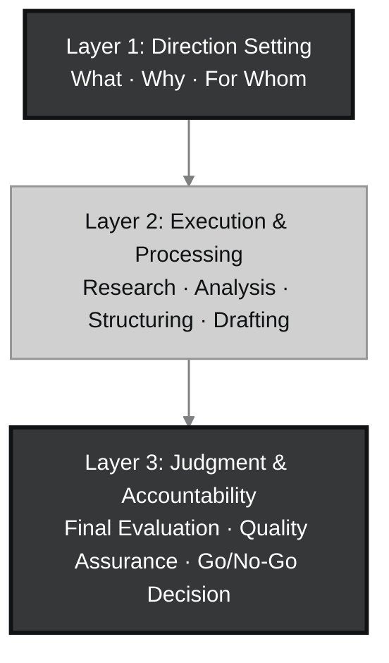

Now, a question.

**"Of your working hours each day, what percentage do you spend on Layer 1, what percentage on Layer 2, and what percentage on Layer 3?**  
**And across these three layers, where and how are you using generative AI?"**

The optimal answer to this question is "the 10:80:10 Principle," the golden ratio of human-AI co-creation.

### 1.3 The Real Problem: The "Co-Creation Relationship" Between Humans and AI Has Not Been Designed

The reason AI adoption fails to deliver the expected results is not a lack of capability in AI. 
It is that no **design of the co-creation relationship** exists between humans and AI.

Many people use AI as a "handy tool": an instrument that returns an answer when you ask a question.
But the role the 10:80:10 Principle defines for AI is not that of a tool. It is that of a **partner**.

A tool moves according to instructions. 
A partner works toward a shared goal, dividing the roles between you. 
The difference is decisive.

When you use AI as a tool, you think about "what to ask AI." 
When you use AI as a partner, you design "how to divide roles between AI and yourself." 
The former stays at the level of making individual tasks more efficient. 
The latter redesigns the very structure of the work.

The Harvard Business School study "Navigating the Jagged Technological Frontier" (Dell'Acqua et al., 2023), 
a large-scale experiment with 758 BCG consultants, showed that the boundary of AI's capabilities has a "jagged" shape — a Jagged Frontier. 
In areas where AI is strong, people using AI performed overwhelmingly better. 
But in areas where AI is weak, people using AI actually performed worse.

The 10:80:10 Principle is a design principle for co-creation that takes this jagged frontier into account. 
It concentrates AI in the areas where AI is overwhelmingly strong (Layer 2: research, analysis, structuring, draft generation), 
and keeps the areas where AI is structurally weak (Layer 1: direction setting; Layer 3: judgment and accountability) in human hands. 
This design of the division of roles is the very essence of the 10:80:10 Principle.

### 1.4 The Quality-Quantity Tradeoff Has Collapsed

Until now, we have assumed that the "quality and quantity" of output stand in a tradeoff relationship. 
It was simply common sense.

Think deeply to raise quality, and producing the output takes longer. 
Move fast to secure quantity, and the quality of the output drops.

**But the moment you design the co-creation relationship of the 10:80:10 Principle, this tradeoff collapses.**

In the first 10%, a human sets the direction for "quality." In the middle 80%, AI generates "quantity" at high speed. In the last 10%, a human guarantees the "quality." 
As a result, Depth (depth and quality) and Velocity (quantity and speed) of output are achieved at the same time.

This is also the core of the "Depth & Velocity" (D&V) methodology. 
D&V is a methodology of intellectual production that pursues "depth" and "speed" simultaneously. 
The traditional tradeoff assumed that one person had to carry both "depth" and "speed" alone. 
The 10:80:10 Principle resolves this tradeoff structurally, through a division of labor in which humans carry "depth" and AI carries "speed."

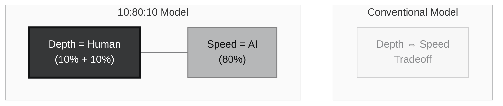

Empirical data supports this structure as well.
In an enterprise-scale study of GitHub Copilot conducted by GitHub together with Accenture, using an AI coding assistant made task completion 55% faster. 
(Corrected November 15, 2026) 
In a writing experiment with 453 participants by MIT economists Shakked Noy and Whitney Zhang, using AI also cut working time by 40% and raised quality by 18%. 
Speed and quality improved at the same time. The tradeoff has collapsed.

### 1.5 Why 5x?

When you apply the 10:80:10 Principle, the golden ratio of human-AI co-creation, your output reaches about five times its former level. 
Here is the basis for that figure.

Traditionally, a human produced 100% of the output on their own. 
With the 10:80:10 Principle, you can hand AI the 80% the output requires and concentrate on the remaining 20%. 
In other words, output of equivalent quality is completed with one-fifth of the former time investment.

Put differently, **you can produce five times the output in the same amount of time.**

This 5x, however, is not "5x by dumping everything on AI." 
It is precisely because a human does high-quality direction design in the first 10% and guarantees quality in the last 10% that the AI processing in the 80% works in the right direction and fivefold productivity is achieved. 
A "0:100:0" approach, missing both the first 10% and the last 10%, yields not 5x but a negative result — just as the HBS × BCG study showed.

### 1.6 "People Who Use AI" vs. "People Used by AI"

As of 2026, the divergence has already begun.

**The key to the divergence is not AI's performance, how often you use it, or prompting technique. It is whether you have designed a co-creation relationship between yourself and AI.**

The most dangerous group is "people who use AI but have not designed the co-creation relationship." 
There are three typical anti-patterns.

**Pattern 1: Surrendering the first 10% to AI.** 
"I'll ask AI what to write before I start." 
This hands direction setting over to AI. 
The result is mass-produced output from which your own will is absent.

**Pattern 2: Submitting AI's output as is.** 
This skips the last 10%. 
A large language model simply keeps choosing the next word with the highest probability of appearing. 
It outputs complete falsehoods, extremely fluently and with great confidence.

**Pattern 3: Using AI only as "an extension of a search engine."** 
You ask, "Tell me about X." You read the answer that comes back. You have it summarize. 
This uses only 5% of the middle 80%. 
The real power of the 80% — structuring, hypothesis generation, exploring alternatives, cross-checking data, iterating on drafts — lies entirely dormant.

The moment you become conscious of the 10:80:10 Principle, your dialogue with AI stops being "question and answer." 
**It turns into continuous orchestration: you "give AI direction, have it execute, evaluate, and re-instruct it."**

### 1.7 The 10:80:10 Principle Is a "Thinking OS"

Finally, let me make clear the most important positioning that runs through this entire book.

Applications run on top of an operating system (OS). 
Writing a proposal, market research, preparing a presentation, coding, writing an article, business planning — all of these are "applications." 
Each has its own best AI tools and its own techniques. 
But whichever application you run, the OS running underneath is the same.

**Set the direction in the first 10%, entrust the middle 80% to AI, and judge in the last 10%.**

A person who has installed this thinking OS can draw out the full power of AI no matter what tools appear, what industry they are in, or what role they hold.

Even when ChatGPT becomes GPT-5. Even when Claude becomes Claude 5. 
Even if, next year, an AI tool appears whose name we don't yet know. 
**The structure of human-AI co-creation will not change.**

Tools get replaced. Models evolve. 
But the structural principle of 10:80:10 — humans hold direction and judgment, while AI accelerates execution — will remain unchanged for as long as the AI era lasts.

In the chapters that follow, this book will take apart each layer of this thinking OS — the first 10%, the middle 80%, and the last 10% — 
concretely, from two angles: findings from cognitive science and practical Before/After scenarios.

> **Chapter 1 References**
> - Dell'Acqua, F., et al. (2023). "Navigating the Jagged Technological Frontier." *HBS Working Paper*, No. 24-013. https://www.hbs.edu/ris/Publication%20Files/24-013_d9b45b68-9e74-42d6-a1c6-c72fb70c7571.pdf
> - McKinsey Global Institute. (2023). *The Economic Potential of Generative AI*. https://www.mckinsey.com/capabilities/mckinsey-digital/our-insights/the-economic-potential-of-generative-ai-the-next-productivity-frontier
> - McKinsey. (2024). *The state of AI in early 2024*. https://www.mckinsey.com/capabilities/quantumblack/our-insights/the-state-of-ai
> - Boston Consulting Group. (2024). *From Potential to Profit with GenAI*. https://www.bcg.com/publications/2024/from-potential-to-profit-with-genai
> - (Corrected November 15, 2026) 
>   Noy, S. & Zhang, W. (2023). "Experimental Evidence on the Productivity Effects of Generative Artificial Intelligence." *Science*, 381(6654), 187–192. https://www.science.org/doi/10.1126/science.adh2586
> - GitHub. (2024). "Quantifying GitHub Copilot's Impact in the Enterprise with Accenture." https://github.blog/news-insights/research/research-quantifying-github-copilots-impact-in-the-enterprise-with-accenture/
> - MIT Sloan Management Review. (2024). "AI and the Workforce." https://sloanreview.mit.edu/projects/artificial-intelligence-and-business-strategy/

 

---

## Chapter 2 — What Is the 10:80:10 Principle? The Full Structural Picture

### 2.1 Refining the Three-Layer Structure: Human Intent / AI Execution / Human Refinement

Chapter 1 showed that all work consists of three layers: "direction setting," "execution and processing," and "judgment and accountability." 
This chapter refines these three layers using the formal terms of the 10:80:10 Principle and defines the concrete components of each phase.

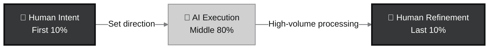

**The First 10%: Human Intent**

This phase sets the overall direction. Specifically, the human designs the following elements.

- **What**: What will be produced. The definition of the deliverable
- **Why**: Why it is needed. Purpose and context
- **Who**: Whom it is for. The resolution of the target reader
- **Constraint**: What will not be done. Setting the constraints
- **Quality Bar**: What counts as finished. The quality standard

More than 50% of the total thinking energy goes into this 10% of the work. 
It takes 10% of the time, but the intellectual density invested here is the highest.

**The Middle 80%: AI Execution**

Based on the intent the human has designed, AI carries out high-volume processing. 
Specifically, this includes the following activities.

- Generating drafts (text, code, design options)
- Gathering and structuring information
- Translation and multilingual expansion
- Analyzing and categorizing patterns
- Generating options exhaustively

The defining characteristics of this 80% are **speed and volume**. 
AI can process in one hour what would take a human ten hours. 
But the quality of this 80% depends entirely on the precision of the intent designed in the first 10%. 
If the intent is vague, AI generates a large volume of "misdirected" output at high speed.

**The Last 10%: Human Refinement**

A human verifies AI's output and settles its final quality. 
Specifically, this includes the following tasks.

- Verifying facts
- Checking logical consistency
- Unifying style and tone
- Removing what is unnecessary (AI is poor at subtraction)
- Adding one's own experience and views
- Making the final decision on whether or not to publish

Like the first 10%, this 10% of the work is an irreplaceable human domain. 
AI cannot objectively evaluate the quality of its own output. 
Metacognition — the ability to know what one does not know — is the greatest capability missing from today's AI, and it is the fundamental reason humans intervene at the end.

### 2.2 Why "10:80:10"? — Comparison with Other Ratios

The 10:80:10 ratio was not chosen arbitrarily. 
Comparing it with other ratios reveals why it is optimal.

**50:50:0 (half human, half AI, no refinement)**

The pattern of using AI as a "fair-copy tool." 
A human writes half, has AI write the rest, and ships it as is. 
The problem with this pattern is that no quality assurance process exists. 
The tone of the human-written parts and the AI-written parts drifts apart, and cracks appear at the logical seams. 
Whoever receives the output senses intuitively that "something is off."

**0:100:0 (all AI)**

The pattern of throwing in a single prompt and publishing AI's output as is. 
You type "Write about X" into ChatGPT or Claude and copy and paste the result. 
This pattern had already proliferated across the internet by 2024 and has become a social problem known as "AI slop." 
In a 2024 blog post, Pandu Nayak, a leader of Google's search quality team, 
cited the flood of low-quality AI-generated content as one of the most important challenges for its ranking algorithms.

**30:40:30 (human-heavy)**

A pattern with low use of AI, in which human workload accounts for 60%. 
Quality is high, but volume does not come out. The pace barely differs from before, and the ROI of AI adoption is low. 
Many large companies' AI rollouts have fallen into this pattern, and it is the source of the complaint, "We adopted AI, but productivity didn't go up." 
In a 2024 Boston Consulting Group survey, about 60% of companies that had adopted generative AI said they had "not achieved the ROI they expected." 
The main cause has been analyzed as a ratio of human intervention that is too high.

**Why 10:80:10 is optimal.**

```mermaid
%%{init: {'theme':'base','themeVariables':{'fontFamily':'Helvetica, Arial, sans-serif','lineColor':'#7f8082','primaryTextColor':'#111213','clusterBkg':'#fafafa','clusterBorder':'#b6b7b8','titleColor':'#363738','edgeLabelBackground':'#ffffff'}}}%%
graph TB
    subgraph "❌ 50:50:0"
        A1["Human 50%"] --- A2["AI 50%"]
        A3["No refinement"]
    end
    subgraph "❌ 0:100:0"
        B1["One prompt"] --- B2["AI 100%"]
        B3["AI slop"]
    end
    subgraph "❌ 30:40:30"
        C1["Human 60%"] --- C2["AI 40%"]
        C3["Insufficient ROI"]
    end
    subgraph "✅ 10:80:10"
        D1["Design 10%"] --- D2["AI 80%"]
        D2 --- D3["Refinement 10%"]
    end

    style A1 fill:#f7f7f7,stroke:#d0d0d1,color:#8a8b8d,stroke-width:1px
    style A2 fill:#f7f7f7,stroke:#d0d0d1,color:#8a8b8d,stroke-width:1px
    style B1 fill:#f7f7f7,stroke:#d0d0d1,color:#8a8b8d,stroke-width:1px
    style B2 fill:#f7f7f7,stroke:#d0d0d1,color:#8a8b8d,stroke-width:1px
    style C1 fill:#f7f7f7,stroke:#d0d0d1,color:#8a8b8d,stroke-width:1px
    style C2 fill:#f7f7f7,stroke:#d0d0d1,color:#8a8b8d,stroke-width:1px
    style A3 fill:#ffffff,stroke:#7f8082,color:#4b4c4e,stroke-width:1px,stroke-dasharray:4 3
    style B3 fill:#ffffff,stroke:#7f8082,color:#4b4c4e,stroke-width:1px,stroke-dasharray:4 3
    style C3 fill:#ffffff,stroke:#7f8082,color:#4b4c4e,stroke-width:1px,stroke-dasharray:4 3
    style D1 fill:#363738,stroke:#111213,color:#ffffff,stroke-width:3px
    style D2 fill:#d0d0d1,stroke:#959596,color:#111213,stroke-width:1.5px
    style D3 fill:#363738,stroke:#111213,color:#ffffff,stroke-width:3px
    linkStyle default stroke:#7f8082,stroke-width:1.5px
```

Concentrating thought in the first 10% maximizes the precision of the direction. 
Entrusting 80% to AI secures speed and volume. 
Having a human guarantee quality in the last 10% secures reliability.

This ratio can also be read as an application of the Pareto principle (the 80:20 rule) to human-AI collaboration. 
Twenty percent of human contribution determines eighty percent of the final value. 
That 20%, however, must be concentrated at the beginning and the end — this is the distinctive insight of 10:80:10.

### 2.3 The 10:80:10 Principle Through the Lens of Creativity Theory

The 10:80:10 structure is also consistent with the major theories of creativity.

**Graham Wallas's four-stage model.**  
In his 1926 book *The Art of Thought*, Wallas divided the creative thinking process into four stages: 
Preparation, Incubation, Illumination, and Verification. 
In the 10:80:10 Principle, Preparation corresponds to the first 10%, the functional equivalents of Incubation and Illumination to AI's 80% of processing, and Verification to the last 10%.

What deserves attention is that "incubation" in Wallas's model — the stage in which you stop thinking about a problem consciously 
and leave it to the unconscious — is structured in 10:80:10 as "the 80% entrusted to AI." 
While a human entrusts 80% to AI, the human unconscious keeps processing the problem in the background. 
The reason you can judge intuitively, when you see AI's output, that "no, this is wrong" or "this is interesting" 
is that your unconscious has been refining your criteria of judgment while your conscious mind left the work to AI.

**Teresa Amabile's theory of intrinsic motivation.**  
As the result of decades of research on creativity, Harvard Business School's Amabile showed 
that the strongest predictor of creative achievement is intrinsic motivation. 
Creativity is driven not by external rewards but by interest in and passion for the work itself.

The 10:80:10 Principle concentrates humans on the phases where intrinsic motivation runs highest — designing questions and finishing quality. 
By entrusting tasks with low intrinsic motivation — data entry, formatting, generating boilerplate text — to AI, 
humans can immerse themselves in the higher-order work that most stimulates their intellectual curiosity. 
This carries an important implication for raising engagement in organizations as well.

**David Epstein's theory of "range."**  
In his 2019 book *Range: Why Generalists Triumph in a Specialized World*, Epstein argued 
that a broad range of experience and knowledge has the advantage over excessive early specialization in creative problem-solving. 
In the first 10% of 10:80:10 — designing the question — the ability to integrate knowledge from diverse fields is decisively important, which matches Epstein's argument.

### 2.4 Before/After: The Difference With and Without 10:80:10

Below is the typical difference between applying and not applying 10:80:10 to the same goal.

**Goal: Create your company's AI strategy proposal within three days**

**Without 10:80:10:**
- Day 1: Unsure what to write, you start by searching for competitors' AI case studies. There is too much information, and the structure never settles
- Day 2: You start writing before you are ready, but the direction changes partway through. You rewrite the first half
- Day 3: You work until midnight, tidy up the formatting, and submit. The result is a proposal that "sort of includes everything"
- Result: 30 pages. Your boss says, "I get it, but so what should we actually do?"

**With 10:80:10:**
- Day 1 morning (first 10%, 3 hours): Narrow the proposal's purpose to "win approval at the management meeting for a ¥30 million AI budget for next fiscal year." Set the audience as "three board members who are not technically savvy." Define the constraints as "no technical details, centered on ROI estimates, no more than 10 pages." Set the quality standard as "one decision point per page, and action items on every page"
- Day 1 afternoon to Day 2 (middle 80%, 8 hours): Ask AI to collect industry benchmarks, build an ROI model, and generate slide structure options. Have it generate three versions of the proposal draft, and choose the most effective one
- Day 3 morning (last 10%, 3 hours): Insert company-specific figures, add anticipated objections based on the board members' past remarks, delete unnecessary pages (15 pages → 10 pages), and rewrite the executive summary in your own words
- Result: 10 pages, with clear decision points and concrete ROI estimates. The budget is approved

This difference is not a difference in ability. It is a difference in process design.

### 2.5 The 10:80:10 Principle Through the Lens of Cognitive Science

The 10:80:10 structure is consistent with several findings in cognitive science.

**Daniel Kahneman's System 1 / System 2 theory.**  
According to the dual-process theory Kahneman presented in his 2011 book *Thinking, Fast and Slow*, 
human thinking has two modes: System 1 (fast, intuitive, unconscious) and System 2 (slow, analytical, conscious). 
The first 10% and the last 10% are phases that require intensive use of System 2. 
The middle 80% is the phase in which AI takes over System 1-like high-speed processing. 
The 10:80:10 Principle is a design that concentrates human System 2 on the two moments where it is most valuable.

**Anders Ericsson's deliberate practice.**  
The concept of "deliberate practice" that Ericsson proposed in a 1993 paper showed that improving expert ability requires high-quality, focused practice. 
In the 10:80:10 Principle, compressing human work into 20% of the whole dramatically increases the density of that 20%. 
Instead of working thinly and broadly, you judge densely and briefly. 
This structure has built into it a mechanism by which expert ability is trained every time you do real work.

**Mihaly Csikszentmihalyi's flow theory.**  
The "flow state" that Csikszentmihalyi elucidated in his 1990 book is the psychological state in which humans perform at their best. 
Flow arises when the difficulty of a challenge is in balance with a person's skill. 
In the 10:80:10 structure, humans concentrate on high-difficulty judgments where their skills matter most (direction design and quality refinement), and entrust repetitive work where their skills do not matter (high-volume processing) to AI. 
This design structurally provides an environment in which humans can enter a flow state more easily.

**George Miller's magical number seven, plus or minus two.**  
The capacity limit of human short-term memory that Miller showed in a 1956 paper — we can process only 7±2 chunks of information at once — explains why humans are not suited to high-volume processing. 
Structuring a 100-page document easily exceeds human cognitive capacity. 
AI has no such limit. 
The 10:80:10 Principle is a design that frees humans from cognitive overload by entrusting processing beyond human cognitive capacity to AI.

### 2.6 The 10:80:10 Principle Through the Lens of Organizational Theory

The 10:80:10 Principle applies not only to individual intellectual production but also to the management of organizations.

In his 1966 book *The Effective Executive*, Peter Drucker argued 
that an executive's most important job is "deciding what not to do." 
This insight matches the first 10% of 10:80:10 — designing the Constraint — precisely.

In his 1979 work on organizational structure, Henry Mintzberg showed 
that strategy formation in organizations has two sides: "deliberate strategy" and "emergent strategy." 
In the 10:80:10 framework, the first 10% corresponds to deliberate strategy, the unexpected outputs AI generates in the middle 80% to emergent strategy, 
and the human act of integrating the two in the last 10% to the realization of strategy.

"The innovator's dilemma" that Clayton Christensen presented in his 1997 book — the structural reason why excellent incumbent companies cannot respond to disruptive technologies — can also be reinterpreted in the context of 10:80:10. 
The biggest reason established organizations fail at adopting generative AI is that they try to "add" AI to their existing processes. 
The 10:80:10 Principle demands not addition but "redesign." 
It re-divides the overall structure of the process into human judgment phases and AI execution phases. 
Without this structural shift, AI adoption ends up as an "expensive autocomplete."

> **Chapter 2 References**
> - Kahneman, D. (2011). *Thinking, Fast and Slow*. Farrar, Straus and Giroux. https://us.macmillan.com/books/9780374533557/thinkingfastandslow
> - Ericsson, K. A., et al. (1993). "The role of deliberate practice." *Psychological Review*, 100(3). https://doi.org/10.1037/0033-295X.100.3.363
> - Csikszentmihalyi, M. (1990). *Flow: The Psychology of Optimal Experience*. Harper & Row. https://www.harpercollins.com/products/flow-mihaly-csikszentmihalyi
> - Miller, G. A. (1956). "The magical number seven, plus or minus two." *Psychological Review*, 63(2). https://doi.org/10.1037/h0043158
> - Drucker, P. F. (1966). *The Effective Executive*. Harper & Row. https://www.harpercollins.com/products/the-effective-executive-peter-f-drucker
> - Mintzberg, H. (1979). *The Structuring of Organizations*. Prentice-Hall. https://www.pearson.com/en-us/subject-catalog/p/structuring-of-organizations-the/P200000005959
> - Christensen, C. M. (1997). *The Innovator's Dilemma*. Harvard Business Review Press. https://www.hbs.edu/faculty/Pages/item.aspx?num=46
> - Wallas, G. (1926). *The Art of Thought*. Jonathan Cape. https://archive.org/details/artofthought00wall
> - Amabile, T. M. (1996). *Creativity in Context*. Westview Press. https://www.hbs.edu/faculty/Pages/item.aspx?num=465
> - Epstein, D. (2019). *Range: Why Generalists Triumph in a Specialized World*. Riverhead Books. https://davidepstein.com/the-range/

 

---

## Chapter 3 — The First 10%: The Art of Designing Questions

### 3.1 Why the "Question" Determines Everything

Measured in time, the first 10% is only a tenth of the whole. 
Yet its influence on the quality of the final deliverable exceeds 50%.

This asymmetry has long been known in the world of software development. 
The cost curve Barry Boehm presented in his 1981 book *Software Engineering Economics* 
showed that when an error from the requirements phase is fixed downstream, the cost balloons by a factor of 100 or more. 
Follow-up work by the IBM Systems Sciences Institute has repeatedly confirmed this "1:10:100 rule": if a fix costs 1 at the design stage, 
it costs 10 at the development stage and 100 after release. 
The same structure applies to human-AI collaboration.

If the "question" designed in the first 10% is inaccurate, AI throws its full 80% of processing power in an inaccurate direction. 
High-speed processing in the wrong direction is more harmful than low-speed processing. 
That is because it generates a large volume of output that is "plausible but misses the point," and the cost of correcting it in the last 10% grows exponentially. 
In a recent survey study that analyzed more than 1,500 academic papers on prompt engineering, 
83.7% of research participants also said that "clearer, more specific prompts lead to better AI results." 
The correlation between the quality of the question and the quality of the output is an empirically established fact.

In practice, the success or failure of a project is all but settled in the first 10%. 
This much can be stated with certainty: 
investing two hours in designing the initial question and getting it done in thirty minutes 
produce a decisive difference in the quality of the final deliverable.

### 3.2 The Five-Layer Structure of Questions

An effective question consists of five layers.

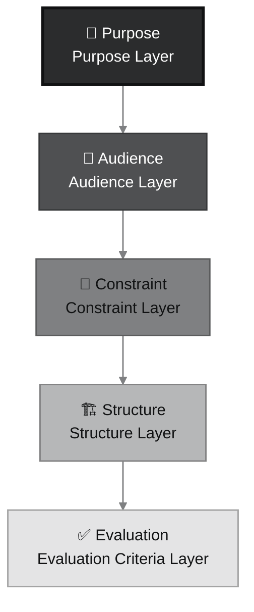

**Layer 1: Purpose**

Putting into words "why we are making this." 
This is the most abstract layer, and the most important.

Before (no question design):  
"I want to write an article about AI."

After (applying 10:80:10): 
"Create supporting material that Fortune 500 CxOs would want to keep at hand to win approval for AI investment at next fiscal year's board meeting."

The difference between these two questions shows up directly as a difference in the final deliverable. 
The former produces a generic AI explainer of the kind that floods the internet. 
The latter produces a practical analysis that can be used for a concrete decision.

**Layer 2: Audience**

Making concrete "whom we are delivering to." 
The resolution of the persona determines the resolution of the content.

Before:  
"For businesspeople."

After:  
"Aged 35–50, business-unit head level in a non-IT department, not interested in AI's technical details, 
  but considering adopting it to raise their department's productivity. Accountable for explaining it to their boss (an executive). Budget authority up to ¥10 million."

This difference in resolution fundamentally changes how practical AI's output is. 
When the audience is vague, AI generates generic output that "applies to everyone but resonates with no one." 
When the audience is clear, AI can generate output tailored to the words that person uses, the challenges they face, and the material they need to make decisions.

**Layer 3: Constraint**

Making explicit "what we will not do." 
It is constraints that unleash creativity.

Charles Eames said that design is optimization within constraints. 
Freedom without constraints in fact paralyzes decision-making through an infinity of options. 
If you tell AI to "write freely," AI generates the most statistically probable — in other words, the most ordinary — output.

Before:  
"Write about the future of AI."
After:  
"Write under the following constraints. Include no technical details. Include no abstract predictions about the future. 
  Limit it to actions that are executable right now. Keep it within 3,000 characters. Draw metaphors from manufacturing."

Designing constraints means deliberately narrowing AI's output space. 
When the output space narrows, AI searches for the optimal solution within that space. 
Returning a "highly precise solution" within a narrow output space is more useful to humans than returning a "so-so solution" across a vast one.

**Layer 4: Structure**

Designing "what skeleton to build on." 
For writing, this means the chapter structure; for a presentation, the flow of slides; for an analysis, the choice of framework.

Before:  
"Write it so it's easy to understand."

After:  
"Write it in the following structure. (1) Open by depicting the concrete problem the reader faces. (2) Break the structural causes of that problem down into three.
  (3) Present a concrete solution for each cause. (4) Present an action plan that integrates the three solutions. (5) End by depicting the state three months after carrying it out."

Designing the structure is the act of giving AI's output a "skeleton." 
Writing without a skeleton does not stay in the reader's memory, however beautiful its style. 
As Barbara Minto showed in her 1987 book *The Pyramid Principle*, logical structure is the foundation of persuasiveness.

**Layer 5: Evaluation Criteria**

Defining in advance "what counts as success." 
You design, at the stage of the first 10%, the criteria you will use to verify quality in the last 10%.

Before:  
"Write something good."

After: 
"It will be evaluated against the following criteria. (1) Does it explain things without jargon? (2) Does each paragraph contain a concrete example?
  (3) Does it state actions the reader can carry out right after reading? (4) Can it be read in three minutes? (5) Does it address the reader's problem in the first three lines?"

Designing evaluation criteria in advance dramatically improves the efficiency of the work in the last 10%. 
If you try to judge quality without criteria, you end up relying on a vague sense of "somehow good / somehow bad," which makes judgment slow and inconsistent.

### 3.3 Three Traps That Prevent Good Question Design

**Trap 1: The perfectionism trap.**  
You try to design the perfect question in the first 10% and never get started. 
A question is a hypothesis, and it should be revised after passing through the 80% of AI processing. 
Iterating — starting with a "good enough question" and revising it after seeing AI's output — is far more effective than designing the perfect question in one shot.

**Trap 2: The over-specification trap.**  
You set so many constraints that you leave no room for AI's emergent output. 
Constraints should set the "direction"; they should not specify the "procedure." 
If you specify a procedure — "do this in step 1, then this in step 2" — 
AI will obediently follow it, but there is no longer any room for it to suggest an angle the human hadn't thought of.

**Trap 3: The abstraction trap.**  
The question is so abstract that AI cannot generate concrete output. 
"Come up with a good strategy" is not a question. 
"Present three patterns, by investment amount, of a strategy for a manufacturer with ¥10 billion in revenue to use AI to improve its cost-of-sales ratio by 3 percentage points within two years" is a question. 
The concreteness of the question and the concreteness of the output are proportional.

### 3.4 In Practice: The First 10% in a New Business Proposal

Here is the actual work process of the first 10% in a project to create a proposal for a new business.

**Time required: 2.5 hours.**

Of this, 1.5 hours were not spent in dialogue with AI but were pure human thinking time. 
Specifically, it consisted of the following activities.

1. **Choosing the theme (30 minutes).**
Cross-referenced industry reports, competitors' moves, and the company's strengths to choose the area to enter. 
The choice of theme was based on first-hand experience of having worked in that business area. 
Choosing a theme without first-hand information runs counter to the 10:80:10 principle.

2. **Putting the questions into words (30 minutes).**
Set three questions: "If a structural change is under way in this market, what is causing it? What conditions must the company meet to ride that change? How large is the return on investment?"

3. **Defining the audience (15 minutes).**
Narrowed the target to "members of the management meeting (three board members plus two business-unit heads)." 
Decided to focus not on technical details but on the information needed for an investment decision.

4. **Designing the structure (30 minutes).**  
Designed the overall section structure and key messages. 
Confirmed that the issues in each section did not overlap, that a logical chain held in which the conclusion of each section became the premise of the next, 
and that the whole worked as a single story.

5. **Setting the evaluation criteria (15 minutes).**  
Set three criteria: "every section contains at least one piece of quantitative data," "zero sections end in abstractions," 
and "the reader has all the material needed to decide on the next action (approve / reject / investigate further)."

These 2.5 hours of work determined the quality and direction of the entire project. 
The remaining 80% was processed rapidly by AI on the basis of this design.

### 3.5 Anti-Pattern Collection for Questions

Here are the typical patterns of failed questions encountered in practice.

**Anti-pattern 1: The "for now" question.**  
"For now, just write something about X." "For now, just do some research." 
A question without direction produces output without direction. AI cannot interpret "for now." 
When a human says "for now," there is a hazy image in their head. 
But AI cannot access that image. 
The moment you feel the urge to say "for now" is the signal that you need to design the question.

**Anti-pattern 2: The "everything included" question.**  
"Write comprehensively about the history, current state, and future of AI, its impact on business, how the technology works, and its ethical issues." 
Cram everything into one question, and AI's output becomes a shallow, broad encyclopedia. 
Questions should be split. 
One question, one focus. If you need several themes, design each as an independent question.

**Anti-pattern 3: The "I already know the answer" question.**  
A question that merely has AI confirm a conclusion you already hold. 
"Prove that X is the best approach." 
This is not a question; it is outsourcing your confirmation bias. 
Instead, you should ask, "Give me the three strongest objections to the approach X." 
AI's value lies not in confirming human hypotheses but in presenting the perspectives humans have overlooked.

**Anti-pattern 4: The "vibes-based quality" question.** 
"Make it cooler." "Make it more professional." "Make it look nice." 
These adjectives are uninterpretable to AI. 
What counts as "cool" differs from person to person, and AI cannot guess the asker's aesthetic sense. 
Instead, you should either hand over a sample of the style you want to reference, 
or specify concrete quality criteria ("each sentence 20 words or fewer," "no passive voice," "draw metaphors from architecture").

**Anti-pattern 5: The "dump it all on AI" question.** 
"Write the minutes of this meeting. There's no recording. There are no notes. I attended, but I don't remember what was said." 
AI cannot create something out of nothing. Without input, there is no output. 
The 10:80:10 Principle is not "a way to take it easy" but "a way to concentrate human work on the areas of highest value." 
Without the investment of the first 10%, the 80% phase does not function.

### 3.6 Using AI to Assist Question Design

It may sound contradictory, but using AI for question design itself is effective. 
The way you use it, however, is different.

Whereas using AI in the 80% phase means "execution based on instructions," 
using AI in the first 10% means "a sounding board for your thinking."

Concretely, the following steps work well.

1. Put the vague idea in your head into words, even if incompletely.
2. Ask AI, "What perspectives am I missing on this idea?"
3. Read AI's answer and revise and refine your question.
4. Show the revised question to AI and ask, "What are the weaknesses of this question?"
5. Finalize the question.

This sounding-board process usually takes 5 to 10 minutes. 
But those 5 to 10 minutes dramatically change the quality of the output in the 80% phase. 
Between an era when human thinking happened "only inside one's own head" and an era when AI can serve as a sounding board, a large difference arises in the precision of questions.

The final decision on the question, however, is made by the human. 
AI presents candidate questions, but choosing which question to pursue is a human judgment. 
The moment you abandon that judgment, the 10:80:10 Principle degenerates into 0:100:0.

> **Chapter 3 References**
> - Boehm, B. W. (1981). *Software Engineering Economics*. Prentice-Hall. https://dl.acm.org/doi/book/10.5555/539404
> - Minto, B. (1987). *The Pyramid Principle*. Minto International. https://www.barbaraminto.com/

 

---

## Chapter 4 — The Middle 80%: Techniques for Collaborating with AI

### 4.1 The Essence of the 80%: AI as an Amplifier

The middle 80% is the phase in which AI is at its most powerful. 
But misunderstand the purpose of this phase, and the whole of 10:80:10 stops working.

AI is not a **creator** but an **amplifier**.

This claim is backed by several large-scale empirical studies.

In the HBS × BCG field experiment with 758 participants introduced in Chapter 1 (Dell'Acqua et al., 2023), 
the AI-using group improved quality by 12.2% and speed by 25.1% on tasks within AI's capability range. 
This effect matches the structure of "amplification" precisely: the higher the quality of the input (the question design in the first 10%), the higher the quality of the output from AI's processing (the 80%). 
A study by Brynjolfsson, Li, and Raymond at NBER covering 5,179 call-center employees 
likewise found that AI assistance raised productivity by 14% on average, and by 34% among the lowest-skilled workers. 
(Corrected November 15, 2026) 
In a writing experiment with 453 participants by MIT economists Shakked Noy and Whitney Zhang, AI use cut working time by 40% and raised quality by 18%.

What these studies showed at the same time, however, was that AI's effect depends heavily on the quality of the input. 
In the HBS × BCG study, on tasks outside AI's capability range, the AI-using group performed worse than the group that did not use AI. 
The researchers called this phenomenon "falling asleep at the wheel." 
By accepting AI's output uncritically, the quality of judgment declined.

This finding strongly supports the 10:80:10 structure. 
Entrusting the 80% phase to AI improves speed and quality, 
but if direction design in the first 10% and quality verification in the last 10% are missing, AI does harm.

This distinction is critically important. 
An amplifier faithfully amplifies the signal fed into it. 
If the input is high quality, the output is high quality. 
If the input is low quality, the low quality is amplified. 
A speaker amplifies beautiful music and noise alike. 
AI, too, processes excellent questions and vague questions alike.

Therefore, the most effective thing you can do to raise the quality of AI's output in the 80% phase 
is not to tune AI's parameters but to raise the quality of the question in the first 10%.

### 4.2 Context Engineering

Since the second half of 2025, "context engineering" has emerged as a concept replacing prompt engineering.

Whereas prompt engineering focuses on "how to write instructions for AI,"
context engineering focuses on "designing the context you hand to AI."
This shift was accelerated by the expansion of the context windows of LLMs (large language models): in 2024, Claude 3.5 implemented a 200K-token context window 
and Gemini 1.5 Pro a 1-million-token one.

In the middle 80% of 10:80:10, context engineering becomes the core technique.

**The four elements of context:**

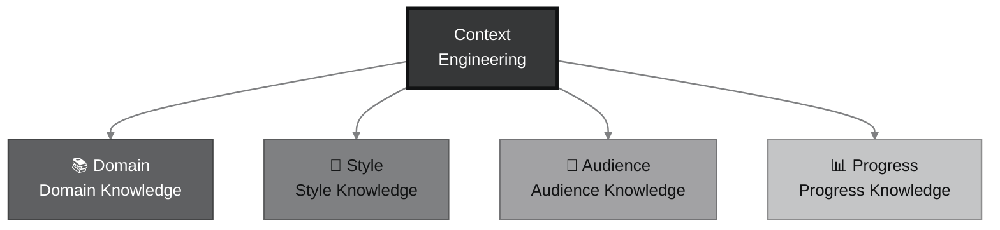

1. **Domain Context.**  
Information about the specialized field that you hand to AI. 
For a research project, the papers, data, and prior studies to reference. 
For a proposal, the industry structure, competitive analysis, and the company's strengths. 
By handing AI, as context, the latest information not included in its training data or unpublished first-hand information, 
you turn AI's output from "generalities anyone could write" into "a distinctive analysis only this person could write."

2. **Style Context.**
Information about the style, tone, and format of the final deliverable. 
If you give AI samples of past deliverables, it learns that style and outputs in a consistent tone. 
This greatly reduces the effort of unifying style in the last 10%.

3. **Audience Context.**  
Information about the readers or users. 
Rather than simply specifying "for executives," handing over concrete information such as "this executive raised point X in the last presentation" 
or "this readership is unfamiliar with concept Y" raises the resolution of AI's output.

4. **Progress Context.**  
Information about the parts already completed. 
When you start on later sections of a large project, if you hand over the finished drafts of the earlier sections as context, 
AI refers to the concepts already introduced, maintains logical consistency, and generates output that avoids repetition. 
Cross-referencing past deliverables and using them as context improves quality and consistency.

### 4.3 Designing Iteration

The 80% phase is not completed in a single exchange. 
You raise quality step by step through iterative dialogue.

**The five-stage model of iteration:**

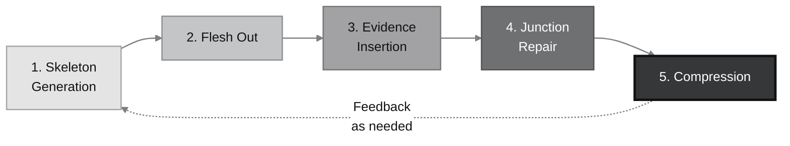

**Stage 1: Skeleton generation.**  
Have AI generate a skeleton at the level of a chapter structure or outline. 
Don't fuss over details at this stage. 
The human checks only the logical consistency of the skeleton.

**Stage 2: Fleshing out.**  
Have AI generate a draft for each section of the skeleton. 
Volume matters at this stage. 
Have it generate several drafts for a single section and choose the best one.

**Stage 3: Evidence insertion.**  
Insert concrete data, quotations, and cases into the draft. 
Any data AI presents must be verified by a human (as a countermeasure against hallucination). 
This is the stage at which you feed in the first-hand information gathered in the first 10%.

**Stage 4: Junction repair.** 
Check and repair the logical connections between sections. 
Sections generated by AI are often excellent individually yet weakly connected to one another. 
The human points out, "The logical jump from here to here is too big" or "This paragraph contradicts the conclusion of the previous section," and has AI fix it.

**Stage 5: Compression.** 
Reduce redundancy across the whole. AI's output is generally redundant. 
It tends to repeat the same thing in different words. 
Apply the principle William Strunk set out in *The Elements of Style* in 1919, 
"Omit needless words," and compress the redundant parts.

### 4.4 How to Surpass AI's Output

There is one principle that matters most when collaborating with AI in the 80% phase.

**What surpasses AI's output is not AI, but human context.**

Changing AI models or honing prompting techniques can only improve output quality so far. 
What fundamentally raises output quality is the quality and quantity of the context humans hand to AI.

The reason a certain project earned high acclaim in the market was not that its AI model was superior. 
It was that dozens of hours of advance research — the target company's public information, IR materials, customer cases, competitive analysis, and an understanding of its technical architecture — 
were handed to AI as context. 
The density of this first-hand information turned AI's output from "commonplace generalities" into "an original structural analysis."

The AI Index Report published in 2024 by Stanford University's Institute for Human-Centered AI (HAI) also confirmed, across several benchmarks, 
that combining human expertise with AI's processing power 
produces results that far exceed either alone.

### 4.5 Hallucination: The Structural Risk of the 80% Phase

An unavoidable issue in the 80% phase is AI hallucination (the generation of information not grounded in fact).

As of 2025, it is impossible to reduce hallucination completely to zero, even with state-of-the-art LLMs. 
Hallucinations are especially likely in the following situations.

- Output containing specific figures (revenue, market size, years)
- Quotations of what a specific person said
- Titles, authors, and journals of academic papers
- The latest events and happenings

The countermeasures against hallucination used in practice have a three-layer structure.

**Layer 1: Countermeasures at generation time.**  
Include in your instructions to AI: "Clearly mark uncertain information as 'needs verification'" and "If the source is unclear, say so." 
This reduces the risk that AI will present information it is unsure of as fact. It is not perfect, but it has some effect.

**Layer 2: Cross-verification.** 
Have two or more AIs check the same fact independently. 
Information on which multiple AIs agree is more reliable. 
When they disagree, a human goes back to the primary source to check.

**Layer 3: Primary-source verification.** 
For the most important facts (the data, quotations, and cases at the core of your argument), a human always checks the primary source. 
For academic papers, Google Scholar or Semantic Scholar; for corporate data, IR materials or SEC filings; for statistics, the original publisher of the data. 
This verification is part of the last 10%, but even in the 80% phase you should immediately flag anything that seems "suspicious."

### 4.6 Before/After: Real Examples from the 80% Phase

**Case 1: Creating a proposal for a new business**

Before (without AI): 
- Two weeks of market research, one week of competitive analysis, one week to draft the proposal, one week of revisions. Five weeks in total.
- Completing a single proposal is the most you can manage.

After (applying 10:80:10):
- First 10%: Half a day to choose the business theme, define the target customers, and design the hypothesis for differentiation.
- Middle 80%: Ask AI to collect and structure market data, analyze competitors' business models, simulate the revenue model, and generate the proposal draft. Done in three days.
- Last 10%: One day to verify facts, reflect the company's own strengths and weaknesses, anticipate and get ahead of management's feedback points, and unify the style.
- Four to five days in total. Three proposals can be produced in parallel in the same period.

**Case 2: Creating presentation materials for an overseas market**

Before (without AI):
- Three days to create the materials in Japanese. One week plus ¥50,000 to outsource the translation. Two days plus ¥30,000 for a native-speaker check. Twelve days plus ¥80,000 in total.

After (applying 10:80:10):
- First 10%: Design the core message and the audience's cultural background in Japanese (2 hours).
- Middle 80%: Ask AI to generate a Japanese draft → translate it into English → adjust cultural nuances (4 hours).
- Last 10%: Check technical terms, add company-specific information, check overall consistency (2 hours).
- One day in total. Zero outsourcing cost. Quality equal to or better than outsourcing (because the understanding of context is higher).

> **Chapter 4 References**
> - Dell'Acqua, F., et al. (2023). "Navigating the Jagged Technological Frontier." *HBS Working Paper*, No. 24-013. https://www.hbs.edu/ris/Publication%20Files/24-013_d9b45b68-9e74-42d6-a1c6-c72fb70c7571.pdf
> - Brynjolfsson, E., Li, D., & Raymond, L. (2023). "Generative AI at Work." *NBER Working Paper*, No. 31161. https://www.nber.org/papers/w31161
> - (Corrected November 15, 2026) 
>   Noy, S. & Zhang, W. (2023). "Experimental Evidence on the Productivity Effects of Generative Artificial Intelligence." *Science*, 381(6654), 187–192. https://www.science.org/doi/10.1126/science.adh2586
> - Stanford University HAI. (2024). *AI Index Report 2024*. https://aiindex.stanford.edu/report/

 

---

## Chapter 5 — The Last 10%: The Art of Refinement

### 5.1 Why the Last 10% Is the Hardest

The last 10% takes the least time of any phase in 10:80:10, yet it demands the highest level of judgment.

This intuitive claim is backed by empirical data. 
A study by Wang et al. (2024) found that, in reviewing AI-generated text, 
when AI verified content it had generated itself, it missed 27% more problems than human reviewers did. 
As a more serious example, a study of medical image diagnosis found that when AI provided an incorrect explanation, the accuracy of X-ray diagnosis plummeted from 92.8% to 23.6%. 
Because humans accepted AI's output uncritically, the result was far worse than it would have been without AI.

General surveys report that 78% of users trust AI output without critical verification. 
A 2025 Microsoft Research study likewise found that while knowledge workers feel AI has made their work "cognitively easier," 
they tend to delegate their problem-solving expertise to AI.

These findings show that the last 10% is not a "nice-to-have" stage but a stage that is "dangerous to skip."

There are three reasons for this.

**First, the judgment of deletion.**  
Deciding what to keep and what to delete from the large volume of output AI generates places a higher cognitive load on you than writing from scratch. 
When writing from scratch, a human moves in one direction, along the flow of their own thinking. 
When editing AI's output, however, you must detect and reconcile the mismatches between AI's flow of thinking and your own.

Antoine de Saint-Exupéry wrote that perfection is achieved not when there is nothing more to add, but when there is nothing left to take away. 
In the AI era, the scarcest skill is not the ability to generate but the ability to delete.

**Second, the judgment of integration.**  
AI can generate individual sections at high quality, but it is poor at integrating the whole into one coherent narrative. 
Elevating each section's "local optimum" into a "global optimum" depends on a uniquely human ability to take in the whole picture.

The principle of Gestalt psychology — "the whole is greater than the sum of its parts" — accurately describes the essence of the last 10%. 
However high the quality of the parts AI generates, no value as a whole emerges unless they are integrated.

**Third, the judgment of publication.**  
The decision to finally "release this to the world" is impossible for today's AI. 
This judgment is made after weighing, all together, whether quality standards are met, whether the timing is right, the likely impact on the audience, 
and the impact on one's own reputation.
AI can present options, but it cannot bear responsibility for the choice.

### 5.2 Six Checkpoints for the Last 10%

Here is a concrete checklist for finishing an intellectual deliverable.

**Check 1: Verify the facts.**  
Go back to primary sources to confirm that the data, quotations, and cases AI presented are accurate. 
Even in models as of 2025, the rate of AI hallucination (output not grounded in fact) has not fallen completely to zero. 
Human verification is essential, especially for specific figures, personal names, years, and quotations.

You should verify on the assumption that AI-generated text contains passages that need factual correction. 
The corrections range from slight discrepancies in figures (writing "$2.7 trillion" where it should be "$2.6 trillion," for example) 
to citations of papers that do not exist (complete hallucinations).

**Check 2: Logical consistency.**  
Do the conclusions of the chapters contradict one another? 
Is a premise stated in Chapter 3 denied in Chapter 7? 
Is there anywhere the chain of logic breaks? 
Even when AI is logical within individual sections, it does not guarantee logical consistency across sections.

**Check 3: Remove redundancy.**  
AI's output is inherently redundant. 
It tends to repeat the same claim two or three times in different words. 
This is a structural property arising from the generation mechanism of LLMs (probabilistically predicting the next token), 
and it cannot be fully eliminated by clever prompting. 
A human needs to read through and delete the duplication.

Because AI drafts contain redundant repetition, compression is unavoidable. 

**Check 4: Add the human voice.**  
What AI's output lacks is insight grounded in unique experience. 
A first-person perspective — "This is what I think," "This is what I learned from that experience" — is something AI cannot generate. 
By explicitly adding the author's own experience, views, and judgment in the last 10%, you give the writing human warmth.

In the AI era, readers do not read content to obtain information. 
Information can be had instantly by asking AI. 
What readers seek in content is a "framework of interpretation": how a particular person interpreted that information, 
how they acted on it, and what they learned.

**Check 5: Unify the tone.**  
Text generated across multiple dialogues with AI can differ subtly in tone from session to session. 
In the last 10%, read the whole thing through and unify the tone. 
Watch in particular for mixed registers (formal and casual), sudden shifts in level of abstraction, and unnatural switches between emotional and analytical expression.

**Check 6: The "So What?" test.**  
Check whether a reader who finishes each section will think, "So what?" 
Presenting information is not enough. 
Each section must state clearly why that information matters to the reader and how it should change the reader's actions.

### 5.3 The Art of Deletion

The most important task in the last 10% is deletion.

In the AI era, the cost of generating content has fallen to nearly zero. 
But readers' attention remains finite, and is in fact shrinking. 
A 2015 Microsoft Research Canada study reported that the average human attention span had dropped to eight seconds. 
(The study's methodology has been criticized, but the direction it points to — attention becoming a scarce resource — is widely supported.)

In a world where content is generated without limit, "what not to write" determines value more than "what to write."

A joint study by UCL and the University of Exeter (*Science Advances*, 2024) revealed another side of this problem. 
Individuals who received AI assistance increased their creativity by 26.6% and their novelty by 10.7%. 
At the same time, however, collective diversity declined — everyone converged on similar output. 
Because AI tends to generate "the most probable output," when many people use the same AI, the output becomes homogenized.

This finding explains scientifically why "deletion" and "adding originality" in the last 10% are indispensable. 
Use AI's output as is, and you end up mass-producing content indistinguishable from that of competitors around the world. 
Only by injecting a human's unique experience and perspective in the last 10% is differentiation achieved.

**Three principles of deletion:**

**Principle 1: Delete duplication.**  
Identify the passages that repeat the same claim in different words, and keep only the single most effective expression.

**Principle 2: Delete prerequisite knowledge.**  
Delete explanations of things the target reader already knows. 
A deliverable for CxOs does not need to explain that "AI stands for Artificial Intelligence…" 
Estimate the reader's level of knowledge accurately, and omit unnecessary explanations.

**Principle 3: Delete self-evident conclusions.**  
Delete conclusions the reader already understands, such as "Therefore, AI is important." 
Keep only insights that exceed the reader's expectations.

### 5.4 Before/After: Real Examples from the Last 10%

**Text generated by AI (Before):**

"Artificial intelligence plays a very important role in modern society. In particular, the emergence of generative AI is bringing about major transformations in many industries. 
  By using AI, companies can improve productivity, reduce costs, and enhance customer experience. 
  Such changes are expected to accelerate further in the future." 

**Text finished in the last 10% (After):**

"Generative AI is not a tool. It is a catalyst for redesigning how an organization thinks. 
  What decides success or failure in adoption is not the precision of the technology but the design philosophy of which judgments humans let go of and which they keep hold of."

The Before text contains no factual errors. But anyone could write it. It can be found anywhere. It does not stay in the reader's memory. 
The After text contains the author's own perspective — the introduction of the concept of "design philosophy" — and offers the reader a new frame for thinking.

This transformation took three minutes. 
But the judgment exercised in those three minutes is impossible for AI.

### 5.5 Time Management for the Refinement Phase

A common pitfall in the last 10% is time ballooning because of perfectionism.

Parkinson's law — "work expands so as to fill the time available for its completion" — shows up conspicuously in the last 10%. 
Even though AI processed the 80% at high speed, if you spend three or four days on the last 10%, you lose the speed advantage of 10:80:10.

**Countermeasure: Set a timebox.** 
Decide and fix in advance how much time you will spend on the last 10%. 
A few hours for a large project. Thirty minutes to an hour for a report. One hour for a proposal. 
If something cannot be finished within this time, either the quality standards are vague or there is a problem with the design of the first 10%.

**Countermeasure: Clarify the "good enough" standard.** 
Rather than aiming for "perfect," publish when the work "meets all the quality standards defined in advance." 
Save improvements beyond the quality standards for the next project. 
Remember Voltaire's words: "The best is the enemy of the good" (*Le mieux est l'ennemi du bien*).

**Countermeasure: Versioning mindset.** 
Especially for OSS and other content that can be updated continuously, publish the first edition as "v1.0," then improve it to "v1.1" and "v2.0" based on feedback. 
Apply software development's "release and iterate" philosophy to intellectual production. 
With OSS content, you can keep updating it after publication based on traffic analysis.

> **Chapter 5 References**
> - Wang, Z., et al. (2024). "AI-generated reviews and human oversight." *CHI 2024*. https://doi.org/10.1145/3613904.3642627
> - Microsoft Research. (2025). "The Impact of AI on Knowledge Worker Cognition." https://www.microsoft.com/en-us/research/publication/the-impact-of-ai-on-knowledge-worker-cognition/
> - Doshi, A. R. & Hauser, O. P. (2024). "Generative AI enhances individual creativity but reduces collective diversity." *Science Advances*, 10(28). https://www.science.org/doi/10.1126/sciadv.adn5290
> - Strunk, W. Jr. (1919). *The Elements of Style*. Harcourt. https://www.gutenberg.org/ebooks/37134
> - Saint-Exupéry, A. de. (1939). *Terre des hommes*. Reynal & Hitchcock. https://archive.org/details/windandsandstars0000sain

 

---

## Chapter 6 — Expanding the Application: To All Intellectual Production

### 6.1 Is the 10:80:10 Principle a Universal Law?

So far, this book has explained 10:80:10 mainly through the example of producing intellectual content. 
But the scope of the principle is not limited to any particular domain.

There are two conditions under which the 10:80:10 Principle applies.

**Condition 1: It is an intellectual production process.**  
A process whose input is information and knowledge and whose output is a structured intellectual deliverable. 
This includes writing, code, design, analysis, planning, and strategy development. 
Purely physical labor and fully routinized clerical processing are outside its scope.

**Condition 2: A quality standard exists.**  
A process for which a standard exists to judge whether the deliverable is good or bad. 
Without a standard, there is no point in designing a question in the first 10% and no point in verifying quality in the last 10%.

Activities that meet these two conditions make up the majority of knowledge work. 
Below, I explain specific areas of application.

### 6.2 Software Development

Software development is one of the domains to which the 10:80:10 Principle applies most naturally.

**First 10%: Architecture design.**  
Requirements definition, design of the overall system architecture, technology selection, definition of non-functional requirements. 
These are sophisticated judgments that integrate an understanding of business requirements, an evaluation of technology trends, and a grasp of the team's capabilities, and they remain in the human domain.

**Middle 80%: Code generation.**  
AI coding tools such as GitHub Copilot, Claude Code, and Cursor generate code based on the design. 
As of 2025, for routine CRUD operations, API implementations, and test code generation, AI achieves speed and quality equal to or better than a human junior engineer.

**Last 10%: Code review, security verification, and integration testing.**  
Verify the quality of the code AI generated, check for security vulnerabilities, and ensure that the system works correctly as a whole. 
This verification follows the principle of "trust but verify" toward AI's output.

In a large-scale GitHub Copilot study, 87% of engineers said it "helped preserve mental effort during repetitive tasks," and 90% said it "made their job more fulfilling." 
The 10:80:10 structure frees engineers from repetitive coding and concentrates them on the higher-order judgments of architecture design and quality assurance. 
This psychological effect — "it becomes easier to enter a flow state" — matches Csikszentmihalyi's theory discussed in Chapter 2.

In Claude Code case studies Anthropic published in 2026, software engineers' code generation speed rose three- to fivefold with AI, 
while human review was shown to be indispensable for keeping the bug injection rate low. 
This matches the 10:80:10 structure precisely.

### 6.3 Strategy Consulting

The work of strategy consulting embodies the 10:80:10 structure most clearly.

**First 10%: Defining the problem.**  
When a client comes in saying "sales are falling," the work is to identify what the real problem is. 
This is a judgment that integrates an understanding of the industry structure, a grasp of the client's organizational dynamics, and a reading of the executives' psychology. 
Frameworks such as McKinsey's "Issue Tree" and BCG's "Value Driver Analysis" are tools for structuring this problem definition.

**Middle 80%: Analysis and document creation.**  
Collecting and analyzing market data, financial modeling, benchmark comparisons, building slides. 
These tasks used to be done by junior consultants late into the night. 
With the introduction of AI, most of these tasks are being automated and accelerated.

**Last 10%: Extracting implications and making recommendations.**  
The work of drawing out implications from the analysis that inform management decisions, and compiling recommendations that support the client's decision-making. 
Even with the same numbers, what story you weave from them and what actions you recommend depend on the consultant's experience and judgment.

### 6.4 Marketing and Branding

**First 10%: Defining the brand's core and customer insight.**  
What do target customers really want? What unique value should the brand deliver? Where are the points of differentiation from competitors? 
These judgments require not only quantitative data but also dialogue with customers, a feel for the "mood" of the market, and an understanding of cultural context.

**Middle 80%: High-volume content generation.**  
Blog posts, social media posts, email newsletters, ideas for ad copy, variations for A/B testing, multilingual expansion. 
AI has already reached a practical level in this area, and a single marketer can generate as much content as an entire team used to.

**Last 10%: Verifying consistency with the brand.**  
Does the content AI generated match the brand's tone of voice? 
Is there any expression that offends the cultural sensibilities of target customers? Any legal risk? Anything that would damage long-term brand value? 
These judgments are a uniquely human ability that requires understanding the brand as a whole.

### 6.5 Education and Training

**First 10%: Defining learning objectives and the audience.**  
What behavioral change should participants show after the training? 
What is their current skill level? What learning barriers exist?

**Middle 80%: Generating teaching materials.**  
Generating lecture materials, exercises, case studies, and quizzes. 
For the same learning objective, AI can instantly generate multiple versions at different levels of difficulty. 
This makes it possible to provide personalized materials matched to each participant's level.

**Last 10%: Verifying and revising educational effectiveness.**  
Observe participants' understanding, verify the effectiveness of the materials, and revise them. 
The ability to read participants' reactions in a classroom or online and adjust materials in real time is a skill unique to human educators. 

### 6.6 Limitations of Application

Let me also be clear about the areas where the 10:80:10 Principle is hard to apply.

**The early stages of pure creative work.**  
The moment a novelist receives their first inspiration, the time a painter spends in front of the canvas searching for a composition, 
the process by which a musician spins out a melody — these do not fit the 10:80:10 structure. 
Entrusting 80% of such activities to AI risks destroying their essential value.

However, in the "production" stage of creative work — revising a novel, arranging a piece of music, producing design variations — the 10:80:10 Principle works effectively. 
The creative process can be broken down into "ideation" and "production," and by applying 10:80:10 to the latter, creators can secure the resources to concentrate on "ideation."

**Interpersonal judgment.** 
In areas where the subtleties of human relationships decide success or failure — performance reviews with subordinates, handling customer complaints, delivering difficult recommendations to management — 
AI's role is limited to providing information and presenting options. 
Judgment and execution should be carried out by humans, and entrusting 80% to AI is not appropriate.

**Ethical judgment.**  
The ethical judgment that determines the scope of AI's use must itself never be entrusted to AI. 
This judgment sits "outside" the 10:80:10 framework.

### 6.7 Research and Analysis

Among all forms of intellectual production, research is the area where the effect of 10:80:10 appears most dramatically.

**First 10%: Designing the research question.** 
What are you investigating? Why? How far will the investigation extend? 
What counts as "done investigating"? Put the direction of the research clearly into words. 

In one research project, 
the research question defined in the first 10% was: "How can this industry's structural transformation be applied to our own business? Where are the limits of that application?" 
The specificity of this question dramatically increased the relevance of the information AI collected in the 80% phase.

**Middle 80%: Data collection, organization, and first-pass analysis.** 
Surveying academic papers, summarizing industry reports, collecting and structuring statistical data, building comparison tables of prior research. 
These tasks used to take researchers and analysts several weeks. 
With AI, they are compressed into hours or days.

The effect is especially large for multilingual research. 
You can investigate papers and reports in English, Japanese, and Chinese side by side and integrate the information without language barriers. 
For example, by combining public information in English (IR materials, technical blogs) with industry analysis in Japanese, 
you can produce an integrated analysis that existed in neither the English-speaking nor the Japanese-speaking world.

**Last 10%: Interpretation and extraction of implications.**  
What does the data mean? Which findings are important, and which are self-evident? 
What is the "So What?" — the guide to action for the reader — that follows from the data? 
This step of interpretation is what turns "a pile of data" into "an intellectual asset."

**Before/After: Creating an industry trends report**

Before (without AI):
- Five days of information gathering (subscribing to trade publications, searching web articles, downloading IR materials)
- Three days of data organization (transcribing into Excel, creating charts)
- Five days of analysis and document creation
- Two days of review and revision
- Fifteen days in total. Once a quarter is the limit. Part of the information is already out of date by the time the report is finished.

After (applying 10:80:10):
- First 10%: Three hours to design the analytical questions, target companies, and axes of comparison.
- Middle 80%: Ask AI to gather, organize, and structure the information and generate a draft. Done in two days. Coverage of information is more than three times that of manual work.
- Last 10%: Half a day to verify facts, extract implications for the company, and add a summary for management.
- Three days in total. It can be produced monthly. It always reflects the latest information.

### 6.8 Personal Knowledge Management

The 10:80:10 Principle can also be applied to personal knowledge management — systematizing your daily learning and insights.

**First 10%: Setting the theme and deciding the structure.**  
Setting a direction such as "This month I'll learn about X" or "I'll organize the notes from this meeting in the context of Y."

**Middle 80%: Structuring information with AI.**  
Hand AI your scattered notes, reading notes, and meeting records, and have it organize, summarize, and link them by theme. 
AI implements the concept of a "second brain" that Tiago Forte proposed in his 2022 book *Building a Second Brain*.

**Last 10%: Adding your own insight.**  
To the information AI has organized, add your own interpretation, connections to your experience, and next actions. 
Leave the structuring of information to AI; the human assigns the meaning.

> **Chapter 6 References**
> - GitHub. (2024). "Quantifying GitHub Copilot's Impact in the Enterprise with Accenture." https://github.blog/news-insights/research/research-quantifying-github-copilots-impact-in-the-enterprise-with-accenture/
> - Forte, T. (2022). *Building a Second Brain*. Atria Books. https://www.buildingasecondbrain.com/

 

---

## Chapter 7 — Organizational Adoption: Implementing 10:80:10 as a Team

### 7.1 From Individual to Organization

The 10:80:10 Principle was designed as a principle of individual intellectual production, but it can also be applied to organizations. 
Applying it in an organization, however, raises challenges that are qualitatively different from applying it as an individual.

For an individual, the "first 10%" and the "last 10%" are carried out by the same person. 
Because design intent and quality standards coincide, no problem of consistency arises. 
In an organization, however, the structure involves multiple people: the leader carries the "first 10%," AI and team members carry the "middle 80%," 
and quality managers or the leader carry the "last 10%."

The biggest risk this structure creates is the **degradation of design intent** (Intent Degradation).

As the intent of the "first 10%" in the leader's head is passed on to team members, its resolution drops. 
It drops further in the prompts members hand to AI. 
As a result, AI's output drifts far from "what the leader was looking for."

### 7.2 The Structure of Intent Degradation

Intent degradation occurs in the following three stages.

```mermaid
%%{init: {'theme':'base','themeVariables':{'fontFamily':'Helvetica, Arial, sans-serif','lineColor':'#7f8082','primaryTextColor':'#111213','clusterBkg':'#fafafa','clusterBorder':'#b6b7b8','titleColor':'#363738','edgeLabelBackground':'#ffffff'}}}%%
graph LR
    L["Leader's<br/>Intent 100%"] -->|"Tacit knowledge<br/>not transferred"| M["Manager's<br/>Understanding 70%"]
    M -->|"Telephone game<br/>degradation"| Me["Member's<br/>Understanding 50%"]
    Me -->|"Context<br/>fragmentation"| AI["Prompt to<br/>AI 30%"]

    style L fill:#262728,stroke:#111213,color:#ffffff,stroke-width:3px
    style M fill:#5f6062,stroke:#444546,color:#ffffff,stroke-width:1.5px
    style Me fill:#a2a2a4,stroke:#747476,color:#111213,stroke-width:1.5px
    style AI fill:#e4e4e5,stroke:#a4a4a4,color:#111213,stroke-width:1.5px,stroke-dasharray:4 3
    linkStyle default stroke:#7f8082,stroke-width:1.5px
```

**Stage 1: Tacit knowledge not transferred.** 
A leader's intent contains premises that have not been put into words (tacit knowledge). 
Behind an instruction like "make it look good" lies a vast body of tacit knowledge: the leader's experience, preferences, past patterns of success, the client's personality, the organization's context, and more. 
Unless this tacit knowledge is explicitly put into words, it does not reach team members.

In his 1966 book *The Tacit Dimension*, Michael Polanyi wrote, "We can know more than we can tell." 
The most important task in introducing 10:80:10 into an organization is converting the leader's tacit knowledge into explicit knowledge — that is, documenting the content of the first 10%.

**Stage 2: Telephone-game degradation.**  
At each step of the transmission chain — leader → manager → member → AI — information is lost and misinterpretations accumulate. 
The "noise" of Shannon and Weaver's 1949 communication model creeps in at every step of transmission.

**Stage 3: Context fragmentation.** 
The prompts handed to AI become fragmentary instructions cut off from the context of the project as a whole. 
AI cannot generate excellent output without context. 
Context fragmentation directly lowers the quality of AI's output.

### 7.3 Three Principles for Organizational Implementation of the 10:80:10 Principle

**Principle 1: Document the first 10% (the Context Document).**

The leader consolidates the project's purpose, audience, constraints, structure, and evaluation criteria into a single document. 
This document is called the "Context Document." 
The Context Document becomes the master source of the context that team members hand to AI.

Elements the Context Document should include:
- The project's purpose and background (Why)
- The definition of the deliverable (What)
- The profile of the audience (Who)
- Constraints (Constraint)
- Quality standards (Quality Bar)
- Past cases and data to reference
- What will explicitly not be done (Anti-Scope)

The leader should invest at least two to four hours in creating this document. 
This investment determines the quality of the entire project.

**Principle 2: Build a "midpoint review" into the 80% phase.**

Rather than running the phase in which AI processes the 80% all at once, conduct a midpoint review when it is 20–30% complete. 
In the midpoint review, check whether AI's output matches the intent of the Context Document, and if a course correction is needed, make it early.

This midpoint review is the same concept as the "sprint review" in agile software development. 
The cost of correcting course after completion reaches five to ten times the cost of correcting it at the midpoint.

**Principle 3: Share the quality standards for the last 10% with everyone.**

If the criteria for quality verification exist only in the leader's head, the last 10% becomes a bottleneck. 
The leader ends up having to review every output alone, and it does not scale.

Document the quality standards as a checklist, and build a system in which team members can verify quality autonomously. 
The leader focuses not on reviewing everything but on sample reviews and handling exceptions.

### 7.4 Redefining Roles in Organizational 10:80:10

Introducing 10:80:10 into an organization redefines existing roles.

**How the manager's role changes.**  
Traditionally, a manager's main role was "managing the progress of work." 
In a 10:80:10 organization, AI handles most of the work, so progress management becomes less important. 
Instead, "quality control of context" — monitoring whether the leader's intent is being conveyed correctly to AI — becomes the main role.

**How the member's role changes.**  
Members who used to be "executors of work" become "AI operators and quality verifiers." 
They hand AI effective context, verify AI's output, and support the first 10% and the last 10%.

**How the leader's role is strengthened.**  
In a 10:80:10 organization, the importance of the leader's "first 10%" — direction design — grows even further. 
Because AI processes the 80% at high speed, losses also accumulate at high speed when the direction is wrong. 
The degree of leverage the quality of the leader's judgment has over the organization's results increases.

### 7.5 Barriers to Adoption and Countermeasures

**Barrier 1: The fear that "AI will take my job."**  
The anxiety that, as the middle 80% is replaced by AI, one's own work will disappear.

Countermeasure: Make clear that the 10:80:10 Principle is not the "elimination" of work but its "reallocation." 
McKinsey's 2025 report "Agents, robots, and us: Skill partnerships in the age of AI" called this structure "superagency." 
Rather than AI replacing humans, human judgment and AI's processing power form a "partnership," 
which the report suggested could unlock $2.9 trillion in economic value per year in the United States alone by 2030. 
Freed from the 80% of repetitive work, members shift to more sophisticated, more intellectually satisfying work: the first 10% (designing questions) and the last 10% (verifying quality). 
The World Economic Forum's Future of Jobs Report 2025 likewise estimates that more jobs will be created by AI than eliminated.

**Barrier 2: Distrust of quality.**  
People do not trust AI's output and rebuild everything from scratch by hand. 
Instead of the 10:80:10 Principle, they revert to 100:0:0.

Countermeasure:  
Pilot 10:80:10 on a small project and measure the difference in quality quantitatively. 
In many cases, the quality of AI's output is higher than skeptics expect. 
In particular, AI clearly outperforms humans in the speed and comprehensiveness of first-draft generation.

**Barrier 3: The skill gap.**  
Team members lack the ability to hand AI effective context.

Countermeasure:  
Standardize the documentation of the first 10%, and share Context Document templates across the organization. 
This reduces the burden on members while guaranteeing a floor for quality.

### 7.6 Before/After: Organizational Application Case

**Case: Creating the monthly report of a new-business department (team of five)**

Before (before AI adoption):
- Each member spends two days on data collection, one day on analysis, and two days on document creation. 5 days × 5 people = 25 person-days.
- Report quality varies widely depending on who is in charge.
- Two days for the department head's review. One day for revisions. 28 person-days in total. Once a month.

After (organizational adoption of 10:80:10):
- The department head creates the Context Document (first 10%). Half a day. "This month's focus is X. The audience is the members of the management meeting. Pay attention to the rate of change from the previous month. Analyze causes along two axes: the external environment and internal initiatives. Limit actions to those that can be carried out by the end of next month."
- Each member, working with AI on the basis of the Context Document, collects data, analyzes it, and drafts the materials (middle 80%). 1 day × 5 people = 5 person-days.
- Self-verification against the quality checklist plus a sample review by the department head (last 10%). Half a day × 5 people + half a day for the department head = 3 person-days.
- 8.5 person-days in total. It can be produced twice a month. Quality is standardized.

### 7.7 Change Management: Embedding 10:80:10 in the Organization

Introducing 10:80:10 into an organization is a problem not of technology adoption but of change management.

The eight-stage change process John Kotter presented in his 1996 book *Leading Change* can also be applied to introducing 10:80:10 into an organization.

**Stage 1: Create a sense of urgency.**  
Rather than saying "If we don't adopt AI, we'll fall behind our competitors," make visible "how much intellectual capacity is being wasted on repetitive work in our current processes." 
Analyze a week of team members' work logs, and reveal the ratio between "high-value work corresponding to the first 10% and the last 10%" and "replaceable work corresponding to the middle 80%." 
In many cases, high-value work accounts for no more than 20% of total working hours.

**Stage 2: Form a guiding coalition.**  
Select three to five "early adopters" who will take the lead in practicing 10:80:10. 
Don't try to change everyone at once; first create a few success stories.

**Stage 3: Clarify the vision.**  
Rather than a vague vision of "becoming more efficient with AI," set a positive vision: "build an organization in which everyone can concentrate on the most intellectual work." 
Repeatedly communicate that the 10:80:10 Principle is not the "reduction" of work but its "reallocation."

**Stage 4: Accumulate small wins.** 
Share the early adopters' success stories — shorter turnaround times, higher quality, praise from customers — across the whole organization. 
Persuade with concrete results, not abstract possibilities.

### 7.8 ROI Measurement Framework

Here is a framework for quantitatively measuring the effects of introducing 10:80:10.

**Metric 1: Time to Delivery.**  
Compare the time it takes to complete the same type of deliverable (reports, proposals, code modules, etc.) before and after introducing 10:80:10. 
In the author's experience, the time savings after adoption should be measured quantitatively.

**Metric 2: Quality Score.**  
Score the quality of deliverables against predefined criteria (factual accuracy, logical consistency, fit to the audience, clarity of actions, etc.). 
Confirm that quality has not declined with the introduction of 10:80:10. In many cases, quality is maintained or improves.

**Metric 3: Throughput.**  
The number of deliverables completed within a given period. 
Because 10:80:10 enables parallel processing, throughput often improves by more than the rate of time savings.

**Metric 4: Rework Rate.**  
The share of deliverables that needed revision after completion. 
If the question design in the first 10% is sound, the rework rate falls. 
Conversely, if the rework rate is rising, there is a problem with the quality of the first 10%.

**Metric 5: Employee Engagement.**  
How members' job satisfaction changed after introducing 10:80:10. If they have been freed from repetitive work and can concentrate on higher-order judgment, engagement rises. 
Conversely, if they feel that "AI took my job," there is a problem with the communication around change management.

> **Chapter 7 References**
> - Polanyi, M. (1966). *The Tacit Dimension*. Routledge & Kegan Paul. https://press.uchicago.edu/ucp/books/book/chicago/T/bo6035368.html
> - Shannon, C. E., & Weaver, W. (1949). *The Mathematical Theory of Communication*. U of Illinois Press. https://press.uillinois.edu/books/?id=p072569
> - Kotter, J. P. (1996). *Leading Change*. Harvard Business Review Press. https://www.kotterinc.com/methodology/8-steps/
> - McKinsey. (2025). *Agents, robots, and us: Skill partnerships in the age of AI*. https://www.mckinsey.com/capabilities/mckinsey-digital/our-insights/agents-robots-and-us
> - World Economic Forum. (2025). *The Future of Jobs Report 2025*. https://www.weforum.org/publications/the-future-of-jobs-report-2025/

 

---

## Chapter 8 — Building Deep Expertise: The Prerequisite for 10:80:10

### 8.1 AI Does Not Turn Beginners into Professionals

There is one point in the discussion of 10:80:10 that is most easily misunderstood. 
It is the misconception that "if AI does 80% of the work, humans only need 20% of the ability."

The answer is a clear no.

A meta-analysis by Vaccaro et al. (*Nature Human Behaviour*, integrating more than 100 experiments) reached a striking conclusion. 
On average, human + AI combinations performed worse than either humans alone or AI alone. 
In content-generation tasks, however, improvements were observed. 
This result means that collaborating with AI does not automatically improve results. 

Research from the LSE (London School of Economics) showed an even starker gap. 
Only the "strong" — people who already had high skills and expertise — were able to benefit from AI. 
Lower-skilled people lacked the ability to evaluate and integrate AI's output appropriately and could not reap AI's benefits. 

A 2026 follow-up study by Professor Ethan Mollick (The Wharton School, University of Pennsylvania) and colleagues reports a further evolution of this structure. 
A single individual with access to AI performed on par with a team of humans without AI. 
By multiplying individual expertise with AI's processing power, results rivaling a whole team became possible. 
But this holds only when that "one person" has sufficient expertise and judgment.

To design high-quality questions in the first 10% and carry out high-quality verification in the last 10%, deep expertise in the domain is indispensable. 
Output generated by AI from questions designed by someone with only a shallow understanding is more dangerous than output written directly by someone with only a shallow understanding. 
That is because AI's output "looks plausible."

The HBS × BCG field experiment with 758 participants introduced in Chapter 1 showed this vividly. 
Consultants who used AI greatly improved their productivity on tasks within AI's capability range. 
But on tasks outside AI's capability range, the group that used AI performed worse than the group that did not. 
The researchers described this as "falling asleep at the wheel."

These experimental results confirm the prerequisite of 10:80:10. 
The ability to evaluate AI's output critically depends on the depth of one's expertise. 
When expertise is shallow, people accept AI's output uncritically and race in the wrong direction at high speed.

### 8.2 From T-Shaped to π-Shaped

So what kind of expertise does the AI era require?

Traditional career development theory has held up the "T-shaped person" — one area of deep expertise plus broad general knowledge — as the ideal. 
But in an era when AI can instantly provide knowledge at the level of "broad general knowledge," the value of the horizontal bar of the T (breadth) declines relatively.

What emerges in its place is the "π-shaped person" — someone with two or more areas of deep expertise.

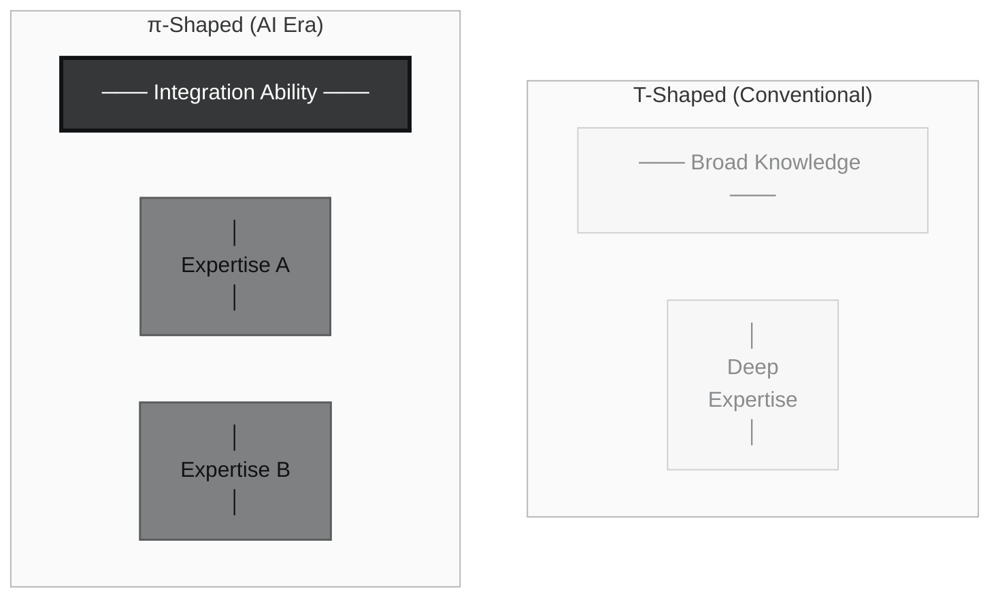

The ability to perform unique integration that AI cannot, at the intersection of multiple areas of expertise, becomes the greatest competitive advantage of the AI era.

For example, at the intersection that crosses three domains — Business design, Technology, and Creative — 
integration becomes possible, such as analyzing a business strategy from the perspective of technical architecture and then structuring it with a design-thinking framework. 
This kind of multi-domain integration is extremely difficult for today's AI.

### 8.3 Using the 10:80:10 Principle to "Sharpen" Expertise

Paradoxically, practicing 10:80:10 is itself training that deepens expertise.

**The first 10% trains your ability to design questions.**
Designing questions requires taking in the whole field, identifying the essential problem, and thinking structurally. 
To hand AI good questions, humans must articulate their own thinking more clearly than ever before. 
This process of articulation itself improves the precision of one's thinking.

The conditions of deliberate practice that Ericsson proposed — clear goals, 
immediate feedback, and practice outside one's comfort zone — are naturally embedded in 10:80:10. 
You design a question (the goal), verify the quality of the question through AI's output (feedback), and raise the precision of your questions little by little each time (expanding your comfort zone).

**The last 10% trains your ability to evaluate.**  
The act of critically evaluating AI's output hones the skill of discerning "the difference between good output and bad output." 
Just as a sommelier trains their palate (the resolution of their sense of taste) by tasting many wines, 
people who evaluate AI's output every day improve their ability to discern quality.

**The 80% phase becomes an opportunity to discover gaps in your knowledge.**  
In the course of reading AI's output, you encounter facts you didn't know, perspectives you had never considered, and issues you had overlooked. 
These discoveries become input for deepening your expertise. Over the course of carrying out multiple projects, the knowledge you learn from AI's output becomes enormous.

### 8.4 The 10:80:10 Principle for Learning

You can apply 10:80:10 to the process of building expertise itself.

**First 10%: Design the learning objective.**
Decide what to learn. 
Not "learn about AI," but design the learning objective at a resolution like: "Understand the mathematical foundations of the attention mechanism in LLMs, 
and be able to explain, in my own words, its potential and limits for business applications."

**Middle 80%: Use AI as a learning partner.**  
Ask AI questions, receive explanations, and check your understanding. 
Dig into the points you don't understand, and have it explain the same concept from different angles. 
AI is the best tutor there is: available 24 hours a day, and never annoyed no matter how many times you ask the same question.

**Last 10%: Output in your own words.**  
Write up what you have learned in your own words, explain it to someone, write a blog post about it. 
Practice, through dialogue with AI, the learning method Richard Feynman advocated — breaking down what you've learned until you could explain it to a child. 
Ask AI, "Is my understanding correct?" and revise your understanding based on its feedback.

The author's own process of acquiring business English is a real example of this 10:80:10 learning. 
The English-speaking environment at a client site (the 10% of practice) → English discussion practice with AI (the 80%) → using it in real work the next day (the 10% of refinement). 
Through this D&V 10:80:10 cycle, the author has experienced learning speeds two to three times faster than with conventional language study.

### 8.5 Cross-Domain Integration Ability

The most valuable ability in the AI era is not depth in a single domain but **the integrative ability to generate new perspectives at the intersection of multiple domains**.

As Frans Johansson argued in his 2004 book *The Medici Effect*, 
breakthrough innovations are born at the intersection of different fields. 
The Medici family's gathering of artists, scientists, and philosophers in Renaissance Florence produced an explosion of creativity.

What matters in the context of 10:80:10 is the fact that AI is extremely good at "processing within a single domain" but still weak at "cross-domain integration." 
"Analyze Palantir's technical architecture with a design-thinking framework and evaluate the innovativeness of its business model" — 
AI cannot carry out a three-domain integration instruction like this unless a human designs the direction of the integration.

As practical approaches to training integrative ability, I recommend the following three.

**First, regular learning in other fields.** 
Regularly expose yourself to content, papers, and conferences in fields different from your main area of expertise. 
The habit of reading one book outside your specialty each week increases discoveries at the intersections.

**Second, training in analogical thinking.** 
A way of thinking that applies the structure of one domain to another. 
Practice posing questions like "How could the franchise model of the restaurant industry be applied to a SaaS company's partner strategy?" as a daily habit.

**Third, dialogue with experts in other fields.**  
Deliberately design opportunities, through LinkedIn and conferences, to talk with professionals whose expertise differs from yours. 
It is important to maximize your points of contact with diverse expertise through professional networks such as LinkedIn.

### 8.6 Before/After: Return on Investment in Expertise

**Case: The difference in results between two marketers using the same AI tool**

Marketer A has ten years of hands-on experience in digital marketing. 
In addition to a deep understanding of Google Analytics, CRM, and advertising platforms, they have knowledge of consumer psychology.

Marketer B has basic marketing knowledge but only two years of hands-on experience. 
They know how to use the tools but have not reached the level of intuitively understanding the structure of consumer behavior behind the data.

Both use the same AI tool (Claude) to develop a marketing strategy for the same product.

Marketer A's first 10%:
"Urban women aged 25–34, disposable income of ¥3–5 million, use social media three or more times a week, health-conscious but short on time. 
Competitor X is concentrating on influencer marketing, so we differentiate through owned channels: SEO and email marketing. 
The KPI is LTV, not CPA. Design it as a 90-day funnel."

Marketer B's first 10%: 
"For women in their 20s and 30s. I want to promote it on social media and the web."

The quality of AI's output mirrors this difference in the first 10% exactly. 
For Marketer A, AI outputs a practical strategy that includes a concrete SEO keyword strategy, email scenario design, and an LTV-based simulation of investment payback. 
For Marketer B, it outputs generalities like "Let's run social media ads; let's improve the website."

The same difference arises in the last 10%. 
Marketer A can check the realism of the CPA estimates AI presented against their own experience and confirm consistency with past campaign data. 
Marketer B has no choice but to accept AI's output as is.

The same AI, the same 80% of processing. Yet a difference in results of more than fivefold. 
What creates this difference is not AI's performance but the depth of human expertise.

### 8.7 The "Compound Interest" Effect of Expertise

There is a reason the practice of 10:80:10 accelerates over time. 
It is that expertise grows at compound interest.

Warren Buffett has repeatedly stressed the power of compounding in investing, and the same principle works in intellectual production.

Each time you practice 10:80:10, the following three "assets" accumulate.

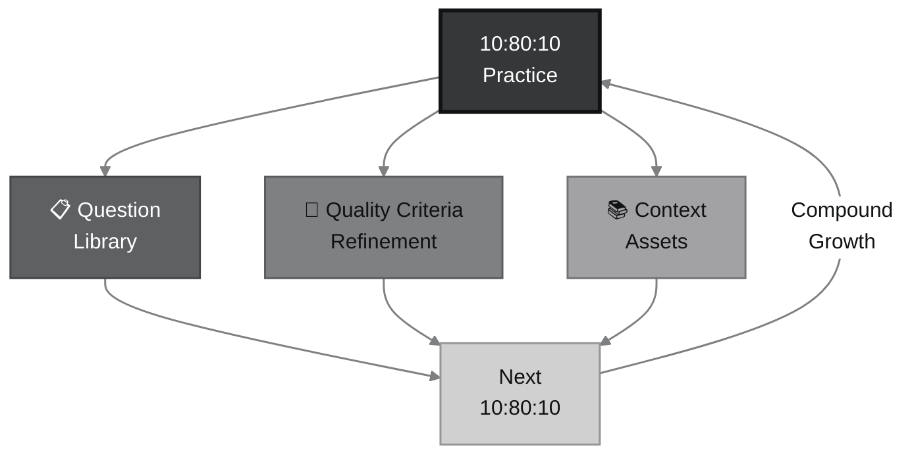

**First, a library of questions.**  
Patterns of questions you have designed in the past accumulate, shortening the time it takes to design similar questions in new projects. 
The more you practice, the less time question design takes. By your tenth project, it takes less than half the time it did the first time.

**Second, refinement of quality criteria.**  
Feedback on past deliverables (reader reactions, GitHub stars, downloads, citations) accumulates, sharpening your sense of "what delivers value to readers." 
As quality criteria become more refined, the speed and precision of your judgment in the last 10% improve.

**Third, context assets.**  
Content you have created in the past becomes reusable as context for new projects. 
In a structure where past deliverables cross-reference one another, the accumulation dramatically thickens the context for new projects.

Because these three assets grow at compound interest over time, 
practitioners of 10:80:10 produce results faster the longer they continue. 
The early practice is the hardest, and it gets easier the longer you keep at it. 
This is the S-curve structure common to all skill acquisition, but 
in the 10:80:10 Principle, AI absorbs part of the learning cost, so the S-curve rises earlier than before.

### 8.8 Expanding the Definition of "Depth"

The "deep expertise" this book has repeatedly emphasized does not necessarily mean degrees or certifications.

In the context of 10:80:10, "depth" refers to **knowledge and experience unique to an individual that AI cannot construct from its training data**.

Some concrete examples:

- The tacit knowledge of someone who has worked in an industry for ten years: "This client is moved by stories, not numbers"
- The lived sense of someone who has changed jobs three times of "how organizational dynamics move people"
- The ability of someone who has balanced raising children and working for ten years to "judge priorities instantly under time constraints"
- The eye of someone who has taken photographs as a hobby for ten years for "intuitively judging the balance of a composition"

These kinds of "depth" are not contained in AI's training data. 
They are knowledge engraved in an individual's body and experience, and they come into play precisely in the first 10% and the last 10% of 10:80:10.

Even without academic credentials or certifications, the 10:80:10 Principle works if you have depth of life experience. 
In fact, the more diverse a person's life experience, the better they can evaluate AI's output from multiple angles and supply the perspectives AI overlooks.

### 8.9 The Half-Life of Expertise

There is an important concept to recognize in the AI era: "the shortening half-life of expert knowledge."

In his 2012 book *The Half-Life of Facts*, Samuel Arbesman 
analyzed quantitatively, as the "half-life of facts," the phenomenon by which the value of expert knowledge decays over time. 
The half-life of medical knowledge is said to be about five years, and that of engineering knowledge about five to ten years.

AI's evolution is shortening this half-life even further. 
Prompt engineering techniques that were state of the art in 2023 had become obsolete by 2025. 
Today's "best practices" may become "old methods" six months from now.

The 10:80:10 principle remains effective because it **does not depend on any particular technique**. 
Even as AI models change and the way prompts are written changes, the structure — "a human sets the direction first, AI processes in the middle, and a human finishes at the end" — stays the same. 
What changes is the tools and techniques used in the 80% phase; the essence of the judgment required of humans in the 10% + 10% phases does not change.

> **Chapter 8 References**
> - Vaccaro, M., et al. (2024). "When combinations of humans and AI are useful." *Nature Human Behaviour*. https://www.nature.com/articles/s41562-024-02024-1
> - Mollick, E. (2026). "Discovering AI's jagged frontier: Updated findings." U of Pennsylvania. https://www.oneusefulthing.org/
> - Ericsson, K. A., et al. (1993). "The role of deliberate practice." *Psychological Review*, 100(3). https://doi.org/10.1037/0033-295X.100.3.363
> - Arbesman, S. (2012). *The Half-Life of Facts*. Current/Penguin. https://www.penguinrandomhouse.com/books/309587/the-half-life-of-facts-by-samuel-arbesman/
> - Johansson, F. (2004). *The Medici Effect*. Harvard Business Review Press. https://www.hbs.edu/faculty/Pages/item.aspx?num=16919
> - Feynman, R. P. (1985). *Surely You're Joking, Mr. Feynman!*. W. W. Norton. https://wwnorton.com/books/Surely-Youre-Joking-Mr-Feynman/

 

---

## Chapter 9 — Ethics and Responsibility: Boundaries of Human-AI Collaboration

### 9.1 Who Takes Responsibility?

Who is responsible for the quality of deliverables produced with the 10:80:10 Principle?

The answer is clear. **Humans are.**

AI has no capacity to take responsibility. AI has no intent, no judgment, no regret. 
If text generated by AI contains a factual error and that error harms readers, it is not AI that is held responsible, but the human who published the text.

This principle is also a structural consequence of 10:80:10. 
In the first 10%, a human designs the direction; in the last 10%, a human verifies quality and makes the decision to publish. 
This design is a structure in which humans explicitly bear final responsibility for quality.

The EU AI Act (which entered into force in 2024) introduced a framework that imposes responsibilities on both the developers and the users of AI systems. 
Responsibilities as a user include the duty to verify AI's output and to ensure that inappropriate output does not harm users or third parties. 
The "last 10%" of 10:80:10 is the phase that structurally fulfills this legal obligation.

### 9.2 The Principle of Transparency

Should deliverables produced with the 10:80:10 Principle disclose that they were made in collaboration with AI?

This book's position is clear. **They should.**

There are two reasons.

**First, integrity.**  
Readers and clients have a right to know how a deliverable was made. 
Disclosing that "this was made using AI" does not imply low quality. 
On the contrary, making the process of collaborating with AI transparent clarifies which judgments humans made and what they are responsible for.

**Second, building trust.**  
In the long run, organizations that disclose their use of AI will be trusted more than organizations that hide it. 
In a society where the use of AI has become universal, "not using AI" is not a differentiator. 
Being able to explain clearly "how you use AI and how humans guarantee quality" is what becomes a differentiator.

For content published as OSS, stating the process of collaborating with AI explicitly is an effective way to build trust. 
It is a statement of confidence in quality and the foundation of a relationship of trust with readers.

### 9.3 Detecting and Correcting AI Bias

AI's output contains biases derived from its training data. 
In the "last 10%" of 10:80:10, detecting and correcting these biases is among the important tasks.

**Amplification of confirmation bias.**  
AI tends to answer in the direction that supports the asker's hypothesis. 
Ask "Is X correct?" and AI will preferentially present evidence pointing toward "correct." 
In the last 10% of 10:80:10, deliberately asking AI for counterarguments — "What is the strongest counterargument to this claim?" — offsets confirmation bias.

**Representativeness bias.** 
AI's training data is overwhelmingly dominated by English-language content. 
The perspectives of Japanese and other language spheres, the situations of emerging economies, and minority views may be relatively underrepresented. 
In the last 10%, it is important to check whether "this analysis is skewed toward a particular region or culture."

**Survivorship bias.** 
AI's training data tends to be skewed toward success stories. 
Data on successful companies covered by the media is abundant, but data on failed companies that went unreported is scarce. 
In the last 10%, it is important to ask, "Is this analysis looking only at successes? What happens if we take failures into account?"

### 9.4 Copyright and Intellectual Property

Under current legal systems, there is a gray zone around the copyright of deliverables produced with the 10:80:10 Principle.

In its 2023 guidance, the U.S. Copyright Office took the position that copyright in AI-generated content depends on "the degree of human creative involvement." 
In the 10:80:10 structure, a human designs the direction in the first 10% and settles the quality in the last 10%, so human creative involvement clearly exists.

However, legal interpretations of this issue differ from country to country and are changing rapidly. 
Readers should check the latest legal interpretation in their own field of business.

The Creative Commons Attribution 4.0 license (CC BY 4.0) that the author of this book has adopted 
is a framework well suited to publishing content created in collaboration with AI. 
It retains copyright while permitting free use and ensuring transparency.

### 9.5 The Risk of AI Dependency

As the practice of 10:80:10 continues over time, there is a risk of becoming dependent on the 80% phase and of the abilities of the first 10% and the last 10% atrophying.

This risk is known as the "irony of automation" (Automation Paradox). 
As Bainbridge pointed out in a 1983 paper, the more automation advances, the more human ability declines for the moments when manual intervention is needed. 
The problem that pilots' manual flying skills decline as aircraft autopilots become highly advanced has been debated in the aviation industry for decades.

A joint study by HBS (Harvard Business School) and UC Berkeley revealed a new aspect of this problem in the AI era. 
Knowledge workers who use AI daily grow more inclined to depend on AI's judgment, 
and a phenomenon of "skill atrophy," in which their ability to solve problems on their own gradually declines, was confirmed. 
Researcher Rembrand Konings has said that, in using AI, we need to think carefully about whether the person using the tool has sufficient judgment.

In the context of 10:80:10, the following countermeasures are effective.

**Deliberate time without AI.**  
Regularly practice writing from scratch without AI. 
By writing a short piece (about 1,000 characters in Japanese, or roughly 500 words) without AI's help once or twice a month, you confirm where your own thinking and expressive abilities currently stand.

**Practice "not looking" at AI's output.**  
In the design phase of the first 10%, put your own hypothesis fully into words before consulting AI. 
Rather than revising your thinking after seeing AI's output, solidify your thinking first and then compare it with AI's output.

**Regular skill inventories.**  
Every six months, ask yourself, "Could I produce a deliverable of the same quality without AI?" 
If the answer is no, that is a warning sign that your 10% + 10% abilities are atrophying.

### 9.6 Designing AI Governance

When an organization introduces 10:80:10, designing AI governance is indispensable.

**A policy on scope of use.**  
A clear line between the work to which AI is applied and the work done by humans alone. 
Define the areas where AI use should be restricted, such as work involving customers' confidential information, drafting documents with high legal risk, and decisions about personnel.

**A quality assurance process.**  
Standardize the review process for AI's output. 
Spell out who reviews, against which criteria, and under what conditions work is sent back. 
Institutionalize the "last 10%" of 10:80:10 as an organizational process.

**Incident response.**  
Procedures for responding when a quality incident caused by AI's output occurs (publishing misinformation, biased decisions, inappropriate handling of customers, etc.). 
In the post-incident root-cause analysis, identify in which phase — the "first 10%," the "middle 80%," or the "last 10%" — the problem arose, and put measures in place to prevent recurrence.

### 9.7 The Societal Impact of 10:80:10

The spread of 10:80:10 has a societal impact that goes beyond individuals and organizations.

The WEF "Future of Jobs Report 2025" (1,000 companies, 55 countries) quantitatively depicts the tectonic shift in skill demand in the AI era. 
The skills whose demand is set to surge most toward 2030 are literacy in AI and big data, 
while demand for "uniquely human judgment" such as critical thinking and creative thinking also ranks near the top. 
The abilities required by the first 10% and the last 10% of 10:80:10 are precisely this "uniquely human judgment."

A 2025 PwC study showed that, in industries highly exposed to AI, growth in revenue per employee was three times that of industries with low exposure (27% vs. 9%). 
AI's benefits are already visible at the industry level, but they are concentrated in companies that have implemented a 10:80:10-like structure — directing AI's processing power with human judgment.

**Narrowing the intellectual divide.**  
The 10:80:10 principle applies equally not only to professionals at large companies 
but also to sole proprietors, freelancers, owners of small and midsize businesses, and even knowledge workers in emerging economies. 
With the cost of accessing AI continuing to fall, the 10:80:10 Principle has the potential to be a tool for democratizing intellectual production.

It has become possible for a single individual, with no organizational support and a marketing budget of zero, to deliver multiple intellectual works to the world in a short period. 
Intellectual production on this scale used to be impossible without an organization's resources. The 10:80:10 Principle dramatically narrows the resource gap between individuals and organizations.

**From "what you know" to "what you can ask."**  
In a society where the 10:80:10 Principle has spread, the value of "knowing the right answer" falls and the value of "being able to ask the right question" rises. 
Education systems, evaluation systems, and hiring criteria are all expected to shift from the amount of knowledge memorized to the ability to design questions.

This change is an unavoidable trend accompanying the development of AI, 
and the 10:80:10 Principle provides a framework for understanding this trend structurally and responding to it consciously.

### 9.8 Data Privacy in Practice

When handing AI context in the 80% phase of 10:80:10, attention to data privacy is indispensable.

**Principle 1: Anonymize confidential information.**  
When handing AI customer names, confidential internal figures, or personal information, always anonymize or abstract them. 
Replace "Company A's revenue of ¥12 billion" with "a manufacturer with revenue on the order of ¥10 billion." 
This reduces the risk of information leakage without greatly degrading the quality of AI's output.

**Principle 2: Check the terms of use.**  
Check the terms of use of each AI service and understand whether input data is used for model training. 
Anthropic (Claude), OpenAI (ChatGPT), and Google (Gemini) all 
allow settings under which input data is not used for training on enterprise plans, while on individual plans it depends on the settings.

**Principle 3: Use local environments.**  
For particularly sensitive work, consider using open-source models that run in a local environment (Llama, Mistral, etc.) rather than cloud-based AI. 
Processing speed and quality fall short of cloud models, but you gain the safety of no data ever being sent outside.

### 9.9 The Future of 10:80:10 and the Evolution of Ethics

As AI's capabilities improve, the ethical challenges of 10:80:10 will evolve as well.

**Short term (1–2 years): Quality and transparency.**  
The more AI's output quality improves, the greater the risk that humans will overlook quality problems. 
Sophisticated hallucinations are harder to detect than crude ones. 
The quality verification skills of the last 10% need to be consciously maintained and improved.

**Medium term (3–5 years): Attribution of creativity.**  
If the creativity of what AI generates in the 80% phase improves, who is the "author" of the final deliverable? 
Even if a human carries the first 10% and the last 10%, if the creative contribution of the 80% lies with AI, 
it may become difficult to handle within conventional concepts of copyright.

**Long term (5+ years): Redefining the human role.** 
If AGI (artificial general intelligence) is achieved, AI may become able to carry the first 10% and the last 10% as well. 
At that point, will the 10:80:10 Principle shift to 0:100:0? The author does not think so. 
I believe that the human act of deciding "what should be made" — setting purpose — will remain a uniquely human domain even after AGI is achieved. 
That is because setting purpose is rooted in value judgments — "What is a good life?" "What is a good society?" — and value judgments belong to human subjectivity.

What the "10%" of 10:80:10 carries may change as AI evolves. 
But the structural principle that "humans set the direction and humans bear responsibility" will endure beyond the evolution of technology.

> **Chapter 9 References**
> - Bainbridge, L. (1983). "Ironies of Automation." *Automatica*, 19(6). https://doi.org/10.1016/0005-1098(83)90046-8
> - European Union. (2024). *Regulation (EU) 2024/1689 — The AI Act*. https://eur-lex.europa.eu/eli/reg/2024/1689/oj
> - U.S. Copyright Office. (2023). "Copyright Registration Guidance: Works Containing Material Generated by AI." *Federal Register*, 88(51). https://www.federalregister.gov/documents/2023/03/16/2023-05321/copyright-registration-guidance-works-containing-material-generated-by-artificial-intelligence
> - PwC. (2025). *AI Jobs Barometer*. https://www.pwc.com/gx/en/issues/artificial-intelligence/job-barometer.html
> - World Economic Forum. (2025). *The Future of Jobs Report 2025*. https://www.weforum.org/publications/the-future-of-jobs-report-2025/

 

---

## Chapter 10 — Conclusion: Design Your Own 10:80:10

### 10.1 Summary of This Book

The core of this book can be summarized in three statements.

**First, the 10:80:10 Principle is a principle for the optimal division of roles between humans and AI.**  
In the first 10%, a human designs the intent; in the middle 80%, AI carries out high-volume processing; in the last 10%, a human settles the quality. 
Through this structure, the quality and quantity of an individual's output reach about five times their former level.

**Second, 20% of human contribution determines 80% of the final value.**  
The first 10% and the last 10% — 20% of human work in total — determine the quality and reliability of the deliverable. 
Investing deep expertise and clear judgment in this 20% is the prerequisite for the 10:80:10 Principle to work.

**Third, the 10:80:10 Principle reinforces itself through practice.**  
The more you practice this principle, the more your ability to design questions (the first 10%) and to verify quality (the last 10%) improves, and as a result, the more effectively you use AI. 
The 10:80:10 Principle is not a static framework but a dynamic learning cycle.

### 10.2 Start Your 10:80:10 Tomorrow

Understanding the theory is worth nothing unless you put it into practice. 
Here are three actions you can start tomorrow.

**Action 1: Don't "dump" your first task on AI (5 minutes).**

Tomorrow morning, when you start your first task, think for just five minutes on your own before giving AI any instructions. 
What do you want to make? For whom? What will you include, and what will you leave out? 
These five minutes are the prototype of the "first 10%." 
Handing AI a question you designed in five minutes and tossing it a thoughtless "do this" produce a decisive difference in output quality.

**Action 2: Don't use AI's output "as is" (10 minutes).**

Read the output AI returns critically for just ten minutes. 
Are the facts correct? Does the logic hold? Where would you have written it differently? 
These ten minutes are the prototype of the "last 10%." 
At first, you may not find anything to fix. 
But as you repeat it, AI's habits — redundancy, lack of specificity, weak conclusions — will become visible.

**Action 3: Consciously practice 10:80:10 on one project (1 day).**

Sometime this week, consciously practice 10:80:10 on one concrete project (writing a report, a proposal, an email, presentation materials, etc.). 
Put half of your total thinking energy into the first 10%, entrust 80% to AI, and polish quality in the last 10%. 
One round of practice is worth more than a hundred rounds of studying theory.

### 10.3 A Phased Adoption Roadmap

Here is a four-phase roadmap for making the practice of 10:80:10 stick.

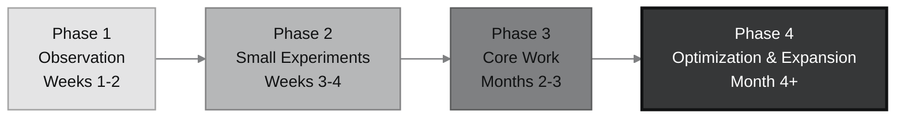

**Phase 1 (Weeks 1–2): Observation.** 
Consciously identify the three phases — "direction design," "execution," and "refinement" — in your current work. 
Record in a notebook which tasks correspond to the "first 10%" and which correspond to the "middle 80%." 
Don't use AI yet. The aim is to understand the structure of your own work.

**Phase 2 (Weeks 3–4): Small experiments.**  
Try 10:80:10 on one small task a week (a 500-character email, a one-page report, a 10-slide presentation). 
Design the question in the first 10%, entrust 80% to AI, and finish in the last 10%. 
Compare the time and quality of this task with your conventional way of working.

**Phase 3 (Months 2–3): Applying it to core work.**  
Apply 10:80:10 to the main intellectual production tasks that come up routinely (weekly reports, proposals, presentation materials, etc.). 
Create a Context Document template for yourself and standardize the process.

**Phase 4 (Month 4 onward): Optimization and expansion.**  
Discover and adjust to the ratio that is optimal for your field (in some cases 15:70:15 or 5:90:5). 
Begin rolling it out to team members and opening up new areas of application.

### 10.4 Self-Assessment for 10:80:10 Practitioners

By answering the following five questions, you can assess your current level of 10:80:10 practice.

**Q1: Before giving AI instructions, do you put the deliverable's purpose, audience, and constraints into words?**
- A: Every time, without fail → The first 10% is established
- B: Sometimes → Conscious practice is needed
- C: Hardly ever → You need to recognize the importance of the first 10% again

**Q2: Before publishing or submitting AI's output, do you verify the facts?**
- A: I verify everything → The last 10% is established
- B: Only the important parts → You need to recognize the risk and widen the scope of verification
- C: Hardly ever → High risk of quality incidents

**Q3: Have you ever discovered, in AI's output, a perspective you would not have thought of yourself?**
- A: Often → You are using the 80% phase effectively
- B: Occasionally → Improving the quality of your context can increase how often this happens
- C: Hardly ever → Your questions in the first 10% may be too closed

**Q4: Have you ever felt "this is wrong" about AI's output and corrected it?**
- A: Often → Your critical evaluation ability is working
- B: Occasionally → Clarifying your evaluation criteria can improve it further
- C: Hardly ever → You may be accepting AI's output uncritically

**Q5: Since you started using 10:80:10, has your ability to think without AI been maintained or improved?**
- A: It has improved → Healthy 10:80:10 practice
- B: It has been maintained → No problem
- C: It has declined → Risk of AI dependency. Deliberate practice without AI is needed

### 10.5 Beyond 5x

The greatest result of practicing 10:80:10 is not that "your output becomes five times larger."

The greatest result is that **humans become able to concentrate on the most human work**.

Repetitive work, organizing data, generating boilerplate text — these tasks were a "waste" of human intellectual ability. 
The human brain has abilities that today's AI has not reached: pattern recognition, abstraction, empathy, and creativity. 
The 10:80:10 Principle is a structure that concentrates humans on these higher-order abilities.

The reason the 10:80:10 Principle lets you produce a large volume of output in a short period is not only that AI processes the 80%. 
It is that, by entrusting 80% to AI, you were able to pour all of your thinking energy into the core of the deliverable — 
the most important questions: "What to convey," "Why to convey it," and "For whom to convey it."

### 10.6 Frequently Asked Questions

**Q: Is the 10:80:10 Principle still valid when AI models change?**

A: Yes. The 10:80:10 Principle does not depend on any specific AI model or technology. 
   Even as models turn over from GPT-3 to GPT-4, or from Claude 2 to Claude 3.5, the structure — "a human designs the direction, AI processes, and a human finishes" — does not change. 
   What changes is the processing quality and speed of the 80% phase, and that change is for the better. 
    The more models evolve, the greater the effect of 10:80:10 becomes.

**Q: Can beginners who don't know much about AI use the 10:80:10 Principle?**

A: No technical knowledge of AI is required. 
   What you need is a deep understanding of your own field and the habit of thinking about "what to ask." 
   Operating AI itself is simply a matter of writing instructions in natural language. 
   In fact, people with deep expertise who know little about AI technology achieve better results with 10:80:10 than people who know a lot about AI technology but have shallow expertise.

**Q: If I leave 80% to AI, won't I lose opportunities to learn?**

A: As discussed in Chapter 8, the 10:80:10 Principle does not take away opportunities to learn; it changes the quality of learning. 
   You lose opportunities to learn from repetitive work, but gain more opportunities to learn from designing questions and verifying quality. 
   The latter has higher long-term career value. 
   You do, however, need countermeasures against the risk of AI dependency (deliberate time without AI, regular skill inventories).

**Q: Can the 10:80:10 Principle be used for personal hobbies and creative activities?**

A: Yes. However, I recommend not applying 10:80:10 to the "ideation" stage of creative activities, and applying it to the "production" stage instead. 
   For example, leave the brainstorming of a novel's plot to pure human creativity, and apply 10:80:10 to production and revision once the plot is settled. 
   For cooking as a hobby, come up with the recipe yourself, and use AI to calculate nutritional balance or consider ingredient substitutions.

**Q: I want to introduce the 10:80:10 Principle to my whole team, but I expect resistance. What should I do?**

A: I recommend the change management approach discussed in Chapter 7. 
   Instead of introducing it to everyone at once, first practice it yourself and produce results. 
   Next, pilot it on a small project together with early adopters (two or three members who are positive about AI). 
   After making the success stories visible, roll it out to the whole team. 
   Not coercion, but natural adoption through the experience of "I tried it and it made things easier," is what lasts longest. 

### 10.7 A Final Message

The title of this book is "The 10:80:10 Principle," but this ratio is not a fixed value.

In some fields, 15:70:15 may be optimal. 
In software development, 5:90:5 may work. 
In artistic creation, 30:40:30 may be appropriate.

What matters is not the exact numbers of the ratio but the design philosophy of **consciously separating the three phases and allocating appropriate resources to each**.

AI's capabilities will continue to evolve rapidly. 
GPT-5, Claude 4, Gemini Ultra — the generational turnover of models will not stop. 
But the structure in which humans set the direction, AI processes, and humans finish will remain valid until AI reaches AGI (artificial general intelligence) — and probably even after it does.

Because the essence of 10:80:10 is not "how to use AI" but **"the design of where human judgment is placed."**

Place your judgment where it creates the most value. 
That is the whole of the 10:80:10 Rule.

---

## About the Author

The author of this book is a cross-domain professional who works across three domains: Business, Technology, and Creative. 
He has systematized an original methodology, "Depth & Velocity" (D&V), and explores how intellectual production should work in the AI era from both practical and theoretical perspectives.

## License

This work is licensed under a [Creative Commons Attribution 4.0 International License (CC BY 4.0)](https://creativecommons.org/licenses/by/4.0/).

**You are free to:**
- **Share** — copy and redistribute the material in any medium or format
- **Adapt** — remix, transform, and build upon the material
- **For any purpose, even commercially**

**Under the following terms:**
- **Attribution** — You must give appropriate credit, provide a link to the license, and indicate if changes were made

---

*The 10-80-10 Principle*
*© 2026. Licensed under CC BY 4.0.*
